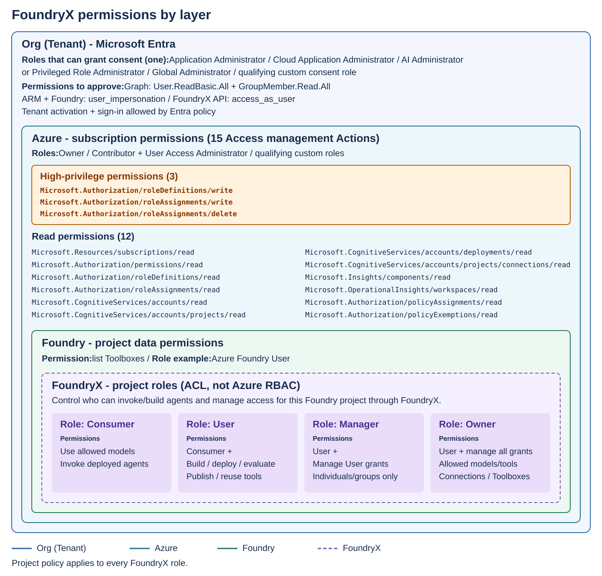

# Admin Center permissions by page

> [!IMPORTANT]
> FoundryX is an experimental project. It is currently available only by invitation to selected customers.

The permissions an administrator needs to **grant access** are separate from
the project permissions that users **receive from that grant**.

| Area | Who it applies to | Permission or result |
| --- | --- | --- |
| **Tenant onboarding** | The Entra administrator who connects the organization. | Requires an eligible [Entra administrator role](tenant-onboarding-requirements.md#administrator-requirements) to approve application permissions. It does not grant employee project access. |
| **Admin Center sign-in** | Users in the active tenant. | Requires sign-in allowed by the tenant's Entra policies. It does not grant project access or authority to grant access. |
| **Authority to grant access** | The administrator registering a project. | Requires all 15 Access management Actions at subscription scope. Owner, Contributor plus User Access Administrator, or custom roles can supply them. Reading Toolboxes also requires native Foundry data access. |
| **Project access granted to users (FoundryX ACLs)** | The selected users, groups, or tenant-wide audience. | Assigns Consumer, User, Manager, or Owner access to a specific project through FoundryX. These are the permissions users receive, not prerequisites for registering the project. |

**FoundryX project access is not a direct Azure role assignment to the user.**

## How the access layers fit together

The layers are **Org (Tenant)**, **Azure**, **Foundry**, and **FoundryX**.
Azure separates high-privilege role changes from read permissions. Foundry
shows native project data permissions. The dashed FoundryX box shows the
project's access list (ACL), not an Azure role. These are separate checks.

## 1. What does tenant onboarding require?

A Microsoft Entra administrator must approve the application permissions and
complete tenant activation. The required administrator roles, consent
permissions, and steps are in
[Tenant onboarding requirements](tenant-onboarding-requirements.md).

Onboarding connects the organization to FoundryX. It does **not** give employees
access to projects or give FoundryX access to Azure resources. An authorized
subscription administrator grants project access separately.

## 2. Who can sign in to the Admin Center?

**Any user in an active, onboarded tenant can sign in**, if the organization's
Microsoft Entra sign-in policies allow it. Users do not need an Entra
administrator role, an Azure subscription role, or a FoundryX project role just
to sign in.

Use the tenant-specific sign-in link. A guest must sign in as a guest of that
tenant, not through their home tenant.

After sign-in:

- Users see enabled projects for which they have a direct, group, or tenant-wide
  FoundryX grant. Without a grant, they have no project access.
- Subscription administrators can also see registered projects in subscriptions
  they manage.
- Users cannot grant or change access merely because they can sign in.

## 3. Who can grant access?

### Register a project through Grant access

> [!NOTE]
> The permission-based check below applies after the authorization update is
> deployed to your environment. Older environments still require built-in
> subscription Owner, or Contributor plus User Access Administrator. Custom-role
> support is not available in those older environments.

FoundryX checks the signed-in person's **actual Azure permissions on the target
subscription**, rather than requiring particular role names. All 15
[Access management Actions](#required-access-management-actions) must be present.
Azure **Owner**, **Contributor plus User Access Administrator**, or custom roles
with the required Actions can provide this access.

Permissions can come from more than one role, group assignments, or inherited
assignments. They must apply at **subscription scope**; Owner on only a resource
group or project is not enough. Activate eligible PIM assignments before
continuing. An Entra administrator role or FoundryX Owner role is not a
substitute.

This is a check of existing permissions. It does **not** assign Azure roles to
the person. When they save a new registration, their Azure authority is used to
provision the FoundryX service principal's access. Azure deny assignments,
policy, and role assignment conditions can still block an operation.

### Required Access management Actions

All of these Actions are required at subscription scope for subscription-wide
Access management, including registering/importing projects and **Remove
access**. They are the full management check, not a minimum permission list for
each individual button.

| Purpose | Required Azure Action |
| --- | --- |
| Read the subscription | `Microsoft.Resources/subscriptions/read` |
| Check the caller's permissions | `Microsoft.Authorization/permissions/read` |
| Read role definitions | `Microsoft.Authorization/roleDefinitions/read` |
| Create or update service role definitions | `Microsoft.Authorization/roleDefinitions/write` |
| Read role assignments | `Microsoft.Authorization/roleAssignments/read` |
| Assign service access | `Microsoft.Authorization/roleAssignments/write` |
| Remove service access | `Microsoft.Authorization/roleAssignments/delete` |
| Read Foundry accounts | `Microsoft.CognitiveServices/accounts/read` |
| Read native projects | `Microsoft.CognitiveServices/accounts/projects/read` |
| Read model deployments | `Microsoft.CognitiveServices/accounts/deployments/read` |
| Read project connections | `Microsoft.CognitiveServices/accounts/projects/connections/read` |
| Read Application Insights resources | `Microsoft.Insights/components/read` |
| Read Log Analytics workspaces | `Microsoft.OperationalInsights/workspaces/read` |
| Read policy assignments | `Microsoft.Authorization/policyAssignments/read` |
| Read policy exemptions | `Microsoft.Authorization/policyExemptions/read` |

FoundryX reads these through the ARM Permissions API using the signed-in user's
delegated token. Action matching supports wildcards and ignores letter case.
Each permission block's `NotActions` exclusions apply to that block; another
block can still grant the Action.

**Creating a new native project is a different check.** The CLI creation
workflow requires 27 Actions: these 15 plus 12 resource-creation and discovery
Actions. Passing Access management alone does not authorize project creation.
The Admin Center's **Grant access** dialog registers an existing project.

### Permissions in the Grant access dialog

The dialog reads Azure resources as the **signed-in administrator**, not as the
FoundryX service principal. Seeing a subscription does not prove that every list
will load.

| Field | What the administrator needs |
| --- | --- |
| Azure subscription | Read subscriptions in the signed-in tenant and check the caller's permissions with `Microsoft.Authorization/permissions/read`. |
| Foundry project | Read the parent Foundry account and its projects. The account must have kind `AIServices`. Already registered projects do not appear here. |
| Users / Groups | The delegated Graph permissions approved during [onboarding](tenant-onboarding-requirements.md#application-permissions-to-approve). The user's directory permissions and guest restrictions still apply. |

Azure role and sign-in checks also read subscription policy assignments and,
when needed, policy exemptions. Complete any Microsoft sign-in or MFA request.

### Allowed models

The model list reads deployments from the **parent Foundry account**, not just
the selected project. The administrator needs these Azure Resource Manager (ARM)
read permissions:

- `Microsoft.Resources/subscriptions/read`
- `Microsoft.CognitiveServices/accounts/read`
- `Microsoft.CognitiveServices/accounts/deployments/read`

These reads are also included in the Access management check. Project-only
access may not cover the parent account. A native Foundry data role is not used
for this list.

### Allowed tools

The tools list needs **both** Azure resource reads and native Foundry data access:

| Access | Where it is needed |
| --- | --- |
| ARM reads of the subscription, account, project, and connections | Includes `Microsoft.CognitiveServices/accounts/projects/read` and `Microsoft.CognitiveServices/accounts/projects/connections/read` on the selected resources. |
| Native Foundry permission to list Toolboxes | On the selected native project, assigned to the administrator's user or group. |

The Azure **[Foundry User](https://learn.microsoft.com/en-us/azure/role-based-access-control/built-in-roles/ai-machine-learning#foundry-user)**
role on the native project is one sufficient data role. It grants more than
read-only access; use an approved role and scope.

**Azure subscription Owner alone does not grant Foundry data access.** An
administrator can therefore see models but fail to load tools. If Toolbox
discovery fails, the whole tools list fails, including built-in choices.
FoundryX **Owner** and Azure **Foundry User** are different roles.

For current picker choices and excluded infrastructure connections, see
[Prepare and allow tools](enterprise-admin-agent-access.md#prepare-and-allow-tools).

### Save access

Select an unregistered project, allowed resources, and at least one user, group,
or tenant-wide audience. Model discovery must succeed before saving. If tool
discovery fails, a new registration can be saved with no allowed tools; this
disables tools rather than fixing the error.

Saving a new access entry does two separate things:

1. **Service access:** Register the project and assign Azure resource roles to
   the customer tenant's FoundryX service principal.
2. **User access:** Save the selected users, groups, or tenant-wide audience and
   their FoundryX project roles. These grants form the project's access control
   list (ACL).

The employee receives project access through FoundryX, not an individual Azure
role assignment. Follow the [Grant access walkthrough](register-project-permissions.md).
If a save fails, inspect the saved state before retrying; some changes may
already be applied.

## 4. What project access do users receive?

In **Users / Groups**, the administrator selects who receives access and assigns
Consumer, User, Manager, or Owner. **FoundryX roles control who can invoke or
build agents and manage access for a specific Foundry project through FoundryX.**
Each assignment is a project access grant (ACL entry).

These roles are assigned during **Grant access**, or added or changed later on
the existing access entry. Recipients do not need these roles before the
administrator grants them access. The roles do not grant direct access in the
native Foundry portal or assign Azure RBAC roles.

| FoundryX role | What it allows | Main limits |
| --- | --- | --- |
| **Consumer** | Use allowed models and invoke deployed agents. | Cannot build or deploy agents, change project access, or change resource settings. |
| **User** | Consumer access plus build, deploy, evaluate, and publish agents; discover and reuse existing connections and Toolboxes. | Cannot manage project membership or change the allowed models/tools. Publishing still needs its separate setup and approval. |
| **Manager** | User access plus add or remove **User** grants for individuals and groups. | Cannot manage Consumer, Manager, Owner, or tenant-wide grants, or change the allowed models/tools. |
| **Owner** | User access plus manage all project roles, change allowed models/tools, and create, change, or delete connections and Toolboxes. | Does not grant Azure subscription authority to register a project or use **Remove access**. |

Roles can be assigned to individuals or groups. A tenant-wide grant supports
only **Consumer** or **User**. If several grants match, the highest role applies:
**Owner > Manager > User > Consumer**.

For example, granting a team **User** access to Project A lets its members build
and deploy agents in Project A through FoundryX. It does not grant access to
Project B, Azure subscription administration, or direct native Foundry access.

The project's allowed model and tool lists apply to **every role, including
Owner**. A role does not bypass those lists or a tool's separate authentication
requirements. An empty list means no access to that resource type.

## Manage access after the first grant

| Admin Center action | Who can do it |
| --- | --- |
| View access details | A project member or an administrator of its subscription. |
| Add, edit, or remove user/group access | Owner or subscription administrator. Manager can manage only User grants for individuals/groups. |
| Change tenant-wide access or allowed models/tools | Owner or subscription administrator. |
| Remove access or retry an incomplete import | Subscription administrator with all required Access management Actions and delegated ARM access. FoundryX Owner alone is not enough. |

Subscription authority does **not** make someone a FoundryX Owner. A subscription
administrator still needs a project role for agent work, and **FoundryX Owner
is required for every connection or Toolbox write**. Deploying or changing model
deployments also needs subscription authority, unless project model management
has been enabled for User, Manager, and Owner.

For existing registrations, model and tool lists use the **FoundryX service
principal's resource access**, not the administrator's personal discovery
access. If these lists fail, check the service principal's roles. The
**Add Users / Groups** dialog does not load model or tool choices.

See [Administration concepts and reference](enterprise-admin-agent-access.md)
for registration grants, resource policy details, and troubleshooting.
