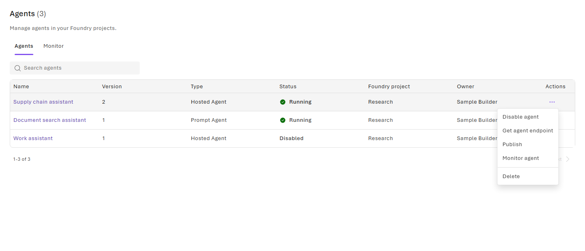
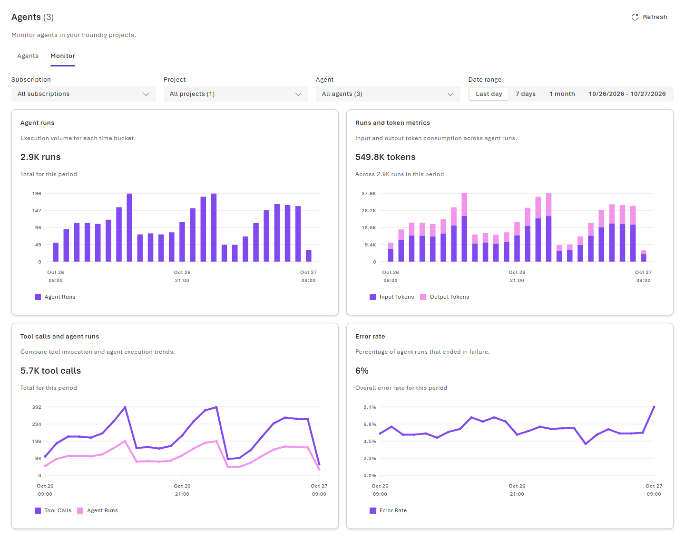
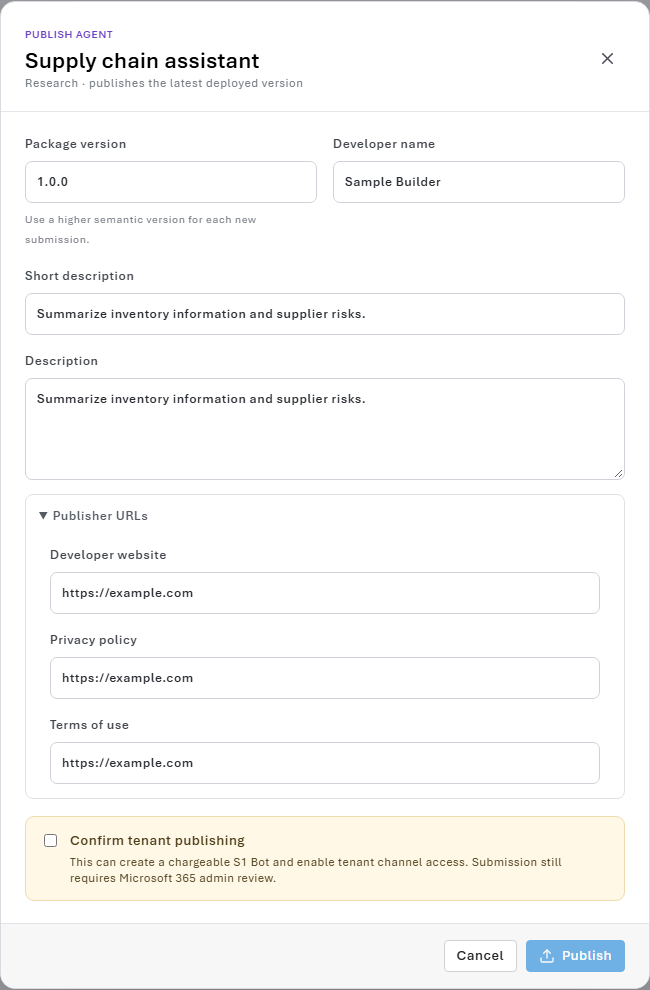

# Walkthrough: Build and operate your first agent

> [!IMPORTANT]
> FoundryX is an experimental project. It is currently available only by invitation to selected customers.

Use this walkthrough to build, deploy, invoke, and inspect your first Microsoft Foundry agent using GitHub Copilot and FoundryX. You don't need your own Azure subscription or individual Azure roles.

For detailed options and troubleshooting, see [FoundryX builder concepts and reference](builder-guide.md).

## Before you begin

Make sure you have:

- An active FoundryX tenant and **User**, **Manager**, or **Owner** access to an enabled project (**Consumer** access allows invoking agents only).
- At least one ready, allowed model deployment in that project (plus any approved tools or Toolboxes you plan to use).
- A local workspace folder in a GitHub Copilot client that can run commands (and Python if you want to test Hosted agents locally).

Deploying, invoking, evaluating, and publishing agents can incur Azure charges. Use non-sensitive sample inputs when testing.

## 1. Install the Copilot plugin

Follow [Get started with the plugin](builder-guide.md#get-started-with-the-plugin) to install `foundry-agent` in VS Code, the GitHub Copilot app, or GitHub Copilot command-line interface (CLI), and then start a new chat session in your workspace. (To update an existing install, see [Upgrade the plugin and CLI](builder-guide.md#upgrade-the-plugin-and-cli).)

## 2. Sign in and verify your access

In Copilot chat, run:

```text
/foundry-agent Help me get started with FoundryX. Check CLI setup and sign-in, then help me choose an accessible project and a ready, allowed model.
```

Copilot checks or installs the `foundryx` CLI, guides you through Microsoft sign-in, lists your accessible projects and allowed models, and verifies deployment permission. If no project or model appears, ask your administrator to grant you **User** access and allow a model deployment.

## 3. Create and deploy the agent

1. In the same chat session, describe the agent you want to build:

   ```text
   /foundry-agent Build a Hosted agent named supply-chain-assistant using the project and model we selected. It should summarize inventory information I provide and identify supplier risks. Start without external tools and do not invent business data. Show the plan and ask before deploying.
   ```

2. Review the generated code, `foundryx.yaml`, and `.agentignore`, and approve the deployment when prompted.

**Expected result:** Deployment succeeds and writes the agent ID, version, and endpoint to `foundryx.yaml`.

### CLI alternative

If you prefer to run the commands yourself, complete [Manual CLI setup (optional)](builder-guide.md#manual-cli-setup-optional) and scaffold the sample:

```powershell
foundryx agent init .\supply-chain-assistant --sample basic
Set-Location .\supply-chain-assistant
```

Update `foundryx.yaml` with your `project` universally unique identifier (UUID), `agent.name`, `agent.model`, and `agent.tool_resources: []`, edit the instructions in `main.py`, and deploy:

```text
foundryx agent deploy
```

(To create a configuration-only agent without Python code, see [Prompt agent](builder-guide.md#prompt-agent).)

## 4. Invoke the deployed agent

Ask Copilot to test your deployed agent:

```text
Invoke the deployed agent with: We have 20 units left and expect 35 orders before the next delivery. Identify the inventory risk and state what other supplier information you need.
```

Or run the CLI command directly:

```text
foundryx agent invoke "We have 20 units left and expect 35 orders before the next delivery. Identify the inventory risk and state what other supplier information you need." --project <project-id> --agent-id <agent-id>
```

To continue the same conversation, pass `--conversation-id <conversation-id>`:

```text
foundryx agent invoke "The next delivery could be three days late. Update the risk summary." --project <project-id> --agent-id <agent-id> --conversation-id <conversation-id>
```

**Expected result:** The deployed agent returns a risk summary based on your prompt.

## 5. Inspect the agent in Canvas

In a Copilot host that supports Canvas, open FoundryX Canvas:

```text
/foundry-agent List all my agents in the FoundryX Canvas.
```



*Example FoundryX Canvas Agents view.*

1. On **Agents**, find your agent and check its **Version**, **Type**, **Status** (**Running**), and **Foundry project**.
2. Select the agent name to view its details, or open **Actions** > **Get agent endpoint** to copy its URL.
3. For a Hosted agent, you can select **Actions** > **Disable agent** or **Enable agent** to start or stop it.

From the CLI, you can run:

```text
foundryx agent list --project <project-id>
foundryx agent show <agent-id> --project <project-id>
```

See [Manage deployed agents in Canvas](builder-guide.md#manage-deployed-agents-in-canvas) for all Canvas actions.

## 6. Add an approved tool (optional)

If your agent needs external tools, ask Copilot to find and configure an approved Toolbox in your project:

```text
/foundry-agent Update this agent to use an existing approved Toolbox in my project. List the available Toolboxes and explain their authentication before changing source. Do not create or replace connections or Toolboxes.
```

1. Choose an approved Toolbox, let Copilot update `main.py` and `agent.tool_resources` (`toolbox:<toolbox-name>`), and redeploy with `foundryx agent deploy` (do not use `agent run` or `--local` for Toolbox agents).
2. Invoke the deployed agent remotely. If prompted with a per-user OAuth consent link, open the link, sign in with the same account, and resume the conversation.

See [Reuse approved tools](builder-guide.md#reuse-approved-tools) for details.

## 7. Evaluate and improve (optional)

To run a billable evaluation on your agent, ask Copilot:

```text
/foundry-agent Set up an evaluation for this agent. Show me the dataset, evaluators, judge deployment, and tool side effects before running it.
```

Review the proposed `eval.yaml`, run the evaluation, and inspect item-level scores before redeploying improvements. See [Evaluate and improve an agent](builder-guide.md#evaluate-and-improve-an-agent).

## 8. Monitor and troubleshoot (optional)

1. In FoundryX Canvas, select the **Monitor** tab, choose your project and agent filters, and select **Refresh**.
2. To inspect Hosted agent logs from the CLI, run:

   ```text
   foundryx agent hosted logs <agent-id> --type console --tail 50 --project <project-id>
   ```

3. To analyze conversation traces in Copilot, ask:

   ```text
   /foundry-agent Analyze my recent calls to this agent for failures and latency. Use my conversation traces and distinguish missing telemetry from zero activity.
   ```



*Example FoundryX Canvas Monitor view.*

See [Monitor and troubleshoot an agent](builder-guide.md#monitor-and-troubleshoot-an-agent).

## 9. Publish to your organization (optional)

Publishing creates a billable Azure Bot channel and submits your agent package for Microsoft 365 or Teams administrator approval.

1. In FoundryX Canvas, select **Actions** > **Publish** (or ask `/foundry-agent Prepare a publishing plan for this agent for organization review. Do not submit yet.`).
2. Enter your package version, descriptions, developer name, and your organization's developer, privacy, and terms URLs.
3. Select **Confirm tenant publishing**, select **Publish**, and complete the publishing sign-in prompt.
4. Check submission status and ask your Microsoft 365 administrator to approve the request:

   ```text
   foundryx agent publish-status <agent-id> --project <project-id>
   ```



*Example FoundryX Canvas Publish form.*

See [Publish to your organization](builder-guide.md#publish-to-your-organization) for CLI options and status codes.
