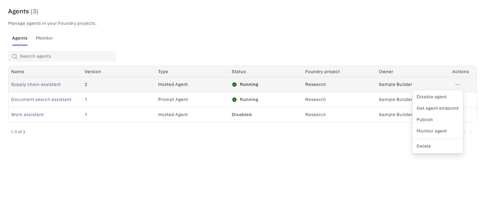
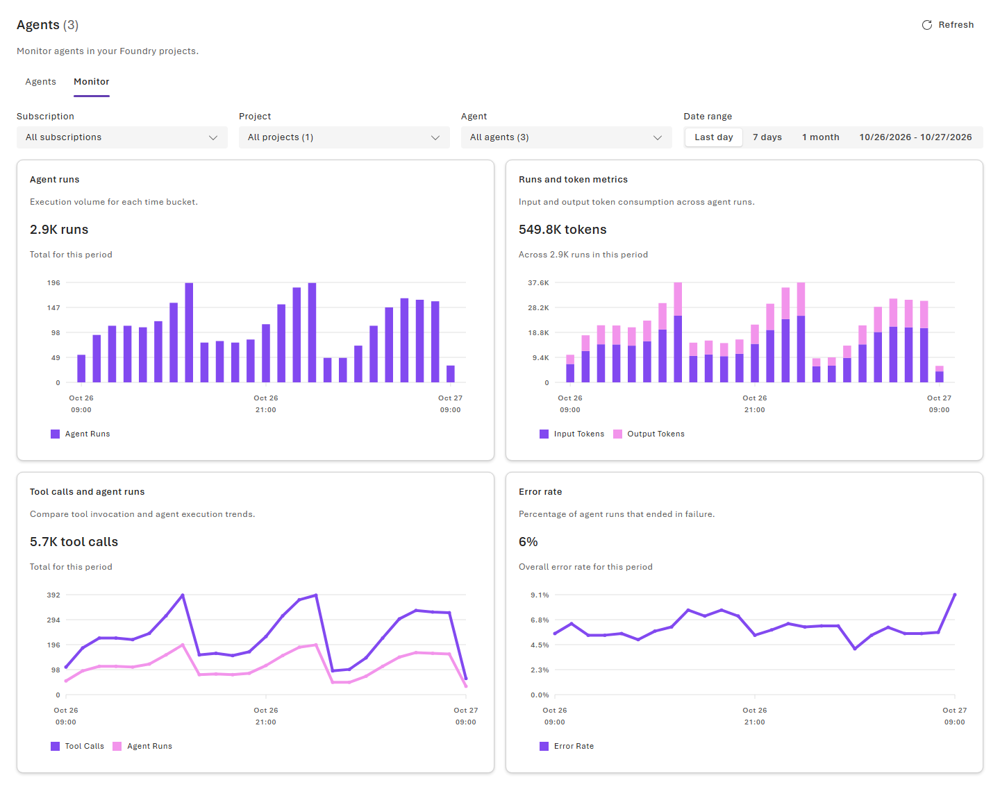
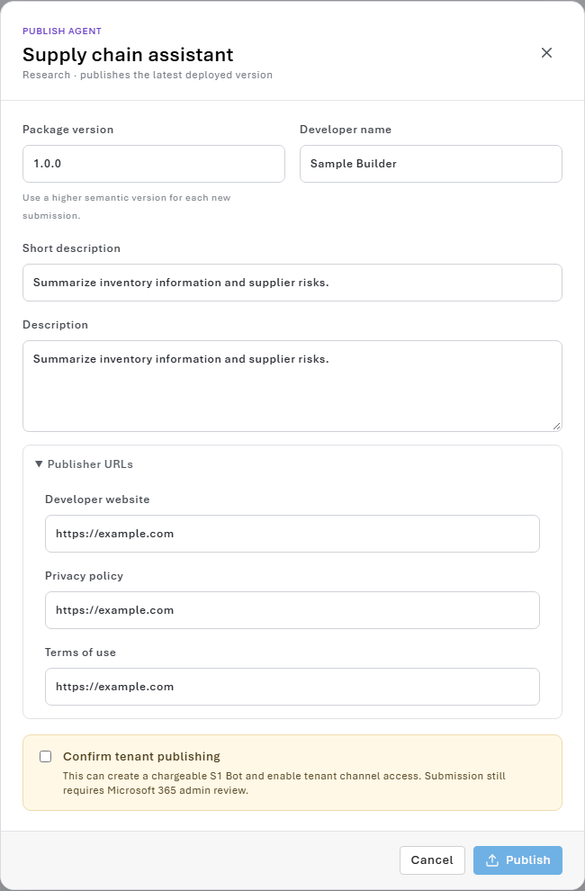

# Walkthrough: Build and operate your first agent

> [!IMPORTANT]
> FoundryX is an experimental project. It is currently available only by invitation to selected customers.

Build an agent in a project prepared by your organization, invoke it, and find it in FoundryX Canvas. This walkthrough uses Copilot for development and shows the equivalent CLI steps. You do not need your own Azure subscription or individual Azure roles.

For role definitions, tools, evaluation, monitoring, and publishing, see [FoundryX Builder concepts and reference](builder-guide.md).

## Before you begin

Confirm these prerequisites:

- Your tenant is active in FoundryX, and your administrator has registered and enabled a Foundry project.
- You have **User**, **Manager**, or **Owner** access to that project. Consumer access permits invocation, not development.
- Know your organization's intended service environment and tenant if they specify one. Copilot can discover accessible projects/models and help you choose.
- The project has a ready, allowed model deployment. Required tools or Toolboxes are already configured and allowed if your agent needs them.
- You have a workspace and a compatible coding-agent client that can execute commands and install user-owned tools when needed.
- Local Hosted Agent testing needs Python and access to its dependencies; Copilot checks those if used. Canvas requires a host with canvas extension support.

Use your own work or school account and approved, non-sensitive sample inputs. This guide contains no shared test accounts or credentials. Deployment, invocation, tools, and later evaluation or publishing can incur charges.

## 1. Install the Copilot plugin

Follow [Install the plugin](../README.md#install) for your client, then start a
new conversation in your workspace. Confirm that `foundry-agent` is enabled.
You do not need to install the CLI manually before continuing.

For an existing installation, see [Upgrade](../README.md#upgrade).

## 2. Sign in and verify your access

Ask Copilot to handle setup and access discovery:

```text
/foundry-agent Help me get started with FoundryX. Check CLI setup and sign-in, then help me choose an accessible project and a ready, allowed model.
```

Copilot checks the existing CLI, installs it only when needed, and guides
Microsoft sign-in. Complete the sign-in flow yourself and answer any environment,
tenant, project, or model questions. Copilot resolves project IDs and checks
deployment authorization; no terminal commands or copied UUIDs are needed.

Continue only when access is allowed. A successful authorization check does not prove that the agent or tools work. If no suitable project or model appears, ask your administrator; do not create a personal Azure subscription as a workaround.

## 3. Create the agent in Copilot

1. Continue in the same workspace and conversation.
2. Describe the Agent you want using the project and model you selected:

   ```text
   /foundry-agent Build a Hosted agent named supply-chain-assistant using the project and model we selected. It should summarize inventory information I provide and identify supplier risks. Start without external tools and do not invent business data. Show the plan and ask before deploying.
   ```

3. Answer Copilot's configuration questions, then review the selected project, model, source, and `foundryx.yaml`. For a Hosted agent, check `.agentignore` so that credentials and unrelated files are not uploaded.
4. Let Copilot complete the requested build and deployment after any required approval. If another agent already has the name, choose a new name unless you intend to update it.

**Expected result:** deployment succeeds, and Copilot reports the agent name, kind, ID, project, model deployment, and version. `foundryx.yaml` records the deployment ID, version, and endpoint. Record whether remote invocation was actually completed; deployment alone is not a runtime test.

### CLI alternative

If you prefer to work directly, follow [Manual CLI setup (optional)](builder-guide.md#manual-cli-setup-optional), then scaffold the basic Hosted sample:

```powershell
foundryx agent init .\supply-chain-assistant --sample basic
Set-Location .\supply-chain-assistant
```

Set these values in the generated `foundryx.yaml`, preserving the other sample settings:

| Setting | Value |
| --- | --- |
| `project` | The selected FoundryX project UUID. |
| `agent.name` | A unique name, such as `supply-chain-assistant`. |
| `agent.model` | The approved deployment name from `model list`. |
| `agent.tool_resources` | `[]` for this tool-free agent. |

Edit the sample instructions in `main.py` to describe the inventory and supplier-risk task. To test locally, run `foundryx agent run`, wait for readiness, and invoke with `foundryx agent invoke "Hello" --local` from another terminal in the same directory. Stop the local server when finished.

Deploy from the agent directory:

```text
foundryx agent deploy
```

For a source-free alternative, use the [Prompt agent configuration](builder-guide.md#prompt-agent). Prompt agents are deployed and tested remotely.

## 4. Invoke the deployed agent

In the same Copilot session:

```text
Invoke the deployed agent with: We have 20 units left and expect 35 orders before the next delivery. Identify the inventory risk and state what other supplier information you need.
```

Or use the CLI with the returned IDs; this works outside the source directory:

```text
foundryx agent invoke "We have 20 units left and expect 35 orders before the next delivery. Identify the inventory risk and state what other supplier information you need." --project <project-id> --agent-id <agent-id>
```

**Expected result:** the remote agent returns an answer based on your input, without claiming to have queried an inventory system. Inspect the content, not only whether the command completed.

For a follow-up in the same conversation, use its returned ID:

```text
foundryx agent invoke "The next delivery could be three days late. Update the risk summary." --project <project-id> --agent-id <agent-id> --conversation-id <conversation-id>
```

Without `--conversation-id`, invocation starts a new conversation. If a previous call has an unknown outcome, inspect it before repeating any operation with side effects.

## 5. Find and inspect the agent in Canvas

In a Canvas-capable Copilot host, the skill normally opens FoundryX Canvas after successful deployment. To open it explicitly:

```text
/foundry-agent List all my agents in the FoundryX Canvas.
```



*The packaged Canvas rendered locally with synthetic example data. No live customer resources or accounts are shown. Preview deployments can differ.*

1. On **Agents**, search for your agent.
2. Check its **Version**, **Type**, **Status**, **Foundry project**, and **Owner**. A ready agent is shown as **Running**.
3. Select the agent name to inspect its details.
4. Open **Actions** > **Get agent endpoint** to inspect and copy a configured protocol URL. Copying an endpoint does not grant access to it.
5. For a Hosted Agent, use **Disable agent** only when you intend to change availability. Use **Enable agent** to restore a disabled agent. Do not select **Delete** as a pause action.

See the [Canvas action reference and CLI equivalents](builder-guide.md#manage-deployed-agents-in-canvas).

The personal list shows agents attributed to you in enabled projects where you have developer access. Agents with unknown creators do not appear. For a host without Canvas, ask Copilot to list your Agents as text. For a project-wide text listing, the direct CLI equivalent is:

```text
foundryx agent list --project <project-id>
foundryx agent show <agent-id> --project <project-id>
```

Canvas shares the CLI account. After switching accounts or tenants, reload it before using it.

## 6. Add an approved tool when needed

Skip this step if your agent needs no external data. For an agent with tools, ask Copilot to discover and reuse existing approved resources:

```text
/foundry-agent Update this agent to use an existing approved Toolbox in my project. List the available Toolboxes and explain their authentication before changing source. Do not create or replace connections or Toolboxes.
```

1. Select a Toolbox that meets your task and project policy. For a prepared demo, use only a resource your administrator confirms is available.
2. Review the selected Toolbox, published or pinned version, returned endpoint, required connections, and user-consent requirements.
3. Have Copilot update the Hosted source using the `toolbox` sample pattern and declare the resource keys in `agent.tool_resources`.
4. Review the change and redeploy. **Do not test Toolbox agents with `agent run` or `--local`.**
5. Invoke remotely with a non-sensitive request that requires the tool. Complete per-user consent if challenged, then resume with the returned conversation ID and the same account.

**Expected result:** an actual tool result supports the answer. Configuration discovery, consent, or a plausible text response alone is not proof of tool execution.

See [approved tools, prepared examples, and consent](builder-guide.md#reuse-approved-tools). Missing resources or expired shared credentials require administrator action.

## 7. Evaluate and improve

Evaluation is optional and billable. Start with:

```text
/foundry-agent Set up an evaluation for this agent. Show me the dataset, evaluators, judge deployment, and tool side effects before running it.
```

After review, authorize the run. Ask Copilot to inspect item-level results, explain failures, and propose improvements. Review source or instruction changes before redeploying. Rerun with the same dataset, evaluators, and judge to compare versions.

**Expected result:** a native evaluation/run ID and evidence for the reported results. Missing scores are not passes. Per-user OAuth tools can behave differently because evaluation uses the backend application identity.

See the [evaluation workflow and CLI commands](builder-guide.md#evaluate-and-improve-an-agent).

## 8. Check operation and diagnose failures

1. In Canvas, select **Actions** > **Monitor agent**.
2. Check the selected project, agent, and time range. Select **Refresh** when needed.
3. If a recent call is missing, verify the filters and allow a few minutes for telemetry ingestion. Do not treat unavailable data as zero.
4. For a failed Hosted call, inspect your latest session:

   ```text
   foundryx agent hosted logs <agent-id> --type console --tail 50 --project <project-id>
   ```

5. For a deeper investigation, ask:

   ```text
   /foundry-agent Analyze my recent calls to this agent for failures and latency. Use my conversation traces and distinguish missing telemetry from zero activity.
   ```



*The packaged Monitor view rendered locally with synthetic telemetry. These values demonstrate the interface, not service performance.*

See [monitoring, traces, and CLI equivalents](builder-guide.md#monitor-and-troubleshoot-an-agent). If monitoring is not configured or access is denied, send the error code and request ID to your administrator without private conversation content.

## 9. Publish only when the agent is ready

Publishing is optional. It can create a chargeable S1 Bot and expose the agent through a tenant channel whose users are not limited to FoundryX project members.

1. Verify the deployed agent and its tool behavior.
2. Open **Actions** > **Publish** in Canvas, or ask `/foundry-agent Prepare a publishing plan for this agent for organization review. Do not submit yet.`
3. Review the package version, descriptions, developer name, real publisher/privacy/terms URLs, costs, and tenant audience.
4. Only when ready to submit, confirm publishing. Complete the separate publishing sign-in with the same tenant and user if requested.
5. Inspect upload status:

   ```text
   foundryx agent publish-status <agent-id> --project <project-id>
   ```

6. Ask your Microsoft 365 tenant administrator to review the submitted request. Verify store availability and end-user chat after approval.



*The packaged Publish form rendered locally with synthetic example data. The confirmation is not selected and nothing was submitted.*

**Expected result:** a submitted request, not automatic tenant approval. If status is uncertain, reconcile it before another attempt. Use a higher explicit package version for a new upload.

See [publishing prerequisites, Canvas fields, and CLI review/confirm steps](builder-guide.md#publish-to-your-organization).

## Completion criteria

The first-agent walkthrough is complete when your own account can access the intended project, deployment succeeds, remote invocation returns the expected answer, and you can inspect the agent in Canvas or the CLI.

Tools, evaluation, monitoring, and publishing are separate checks. Record any step you skipped or could not verify; do not report those features as complete based only on deployment.
