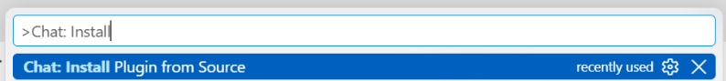
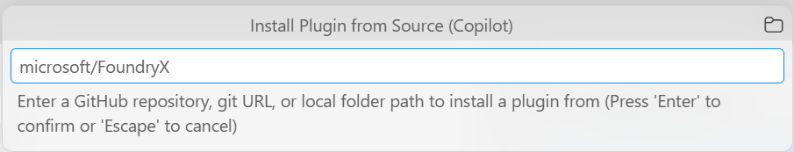
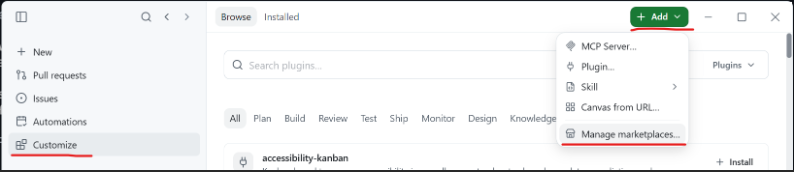
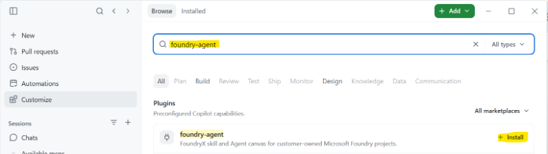

# FoundryX Builder concepts and reference

> [!IMPORTANT]
> FoundryX is an experimental project. It is currently available only by invitation to selected customers.

Use FoundryX to build and operate agents in a Microsoft Foundry project that your organization has prepared. Sign in with your work or school account. You do not need your own Azure subscription or an individual Azure role for the normal Builder workflow.

This page explains Builder access, CLI and Canvas capabilities, tools, evaluation, monitoring, and publishing. To build your first agent, follow [Walkthrough: Build and operate your first agent](build-first-agent.md).

Your organization retains ownership of its Azure resources, quota, costs, and security policy. Agent deployment, model calls, tools, evaluation, and publishing can incur charges. Use approved data and review operations before running them.

## In this reference

- [Get started with the plugin](#get-started-with-the-plugin)
- [Install in VS Code or VS Code Insiders](#vs-code-or-vs-code-insiders)
- [Install in the GitHub Copilot app](#github-copilot-app)
- [Install in GitHub Copilot CLI](#github-copilot-cli)
- [Upgrade the plugin and CLI](../README.md#upgrade)
- [Understand Builder access](#understand-builder-access)
- [Choose CLI, Copilot, or Canvas](#choose-cli-copilot-or-canvas)
- [Configure and develop an agent](#configure-and-develop-an-agent)
- [Reuse approved tools](#reuse-approved-tools)
- [Manage deployed agents in Canvas](#manage-deployed-agents-in-canvas)
- [Evaluate and improve an agent](#evaluate-and-improve-an-agent)
- [Monitor and troubleshoot an agent](#monitor-and-troubleshoot-an-agent)
- [Publish to your organization](#publish-to-your-organization)
- [Manual CLI setup (optional)](#manual-cli-setup-optional)
- [Troubleshoot](#troubleshoot)

## Get started with the plugin

Install the `foundry-agent` plugin in your coding-agent client using one of
the client-specific sections below. Then start a new conversation in a workspace
you control and [describe the Agent you want](../README.md#use). Let the skill
check CLI setup, guide sign-in, discover your accessible projects/models, and
run the requested workflow.

No manual CLI installation or terminal preflight is required for this path.
The CLI remains a separate runtime dependency: the skill installs it if missing
or updates it when a compatibility issue requires one, keeping a working installation.
If the intended service environment or tenant is unclear, supply your organization's
choice when asked. You complete Microsoft sign-in and approve requested operations.
Never put passwords, tokens, or connection keys into chat.

Your tenant and project access must already be available; the plugin cannot grant
them. The coding-agent host must support command execution. Local Hosted Agent
testing additionally needs Python and access to its dependencies; the coding agent
checks those when that path is used. Canvas needs a host with canvas extension
support, but is not required for the CLI workflow.

See [Upgrade](../README.md#upgrade) for plugin updates and agent-guided CLI checks.
Use [Manual CLI setup](#manual-cli-setup-optional) only for direct terminal use or troubleshooting.

The plugin name is `foundry-agent`. Its marketplace source is
`microsoft/FoundryX`, and the marketplace name is `foundryx`. Adding the
marketplace makes the plugin available to browse; it does not install the plugin.

### Before installing

If `foundry-agent` is installed from another repository or marketplace, uninstall
that copy before installing from this repository. Existing installations do not
automatically switch sources.

Do not load duplicate copies of the same skill/canvas. Before activating this
plugin, remove or disable a separately installed `foundry-agent` skill and the
standalone `foundry-canvas` extension. Inspect their locations first and remove
only those exact components; do not delete shared Copilot configuration or the
CLI credential cache. The native `microsoft-foundry` plugin can remain installed:
its builder canvas uses a different canvas ID.

### VS Code or VS Code Insiders

1. Install [VS Code](https://code.visualstudio.com/download) or
   [VS Code Insiders](https://code.visualstudio.com/insiders/). Set up
   [GitHub Copilot in VS Code](https://code.visualstudio.com/docs/copilot/setup)
   and sign in with your GitHub account.
2. Open the Command Palette: **Ctrl+Shift+P** on Windows/Linux or
   **Cmd+Shift+P** on macOS.
3. Run **Chat: Install Plugin from Source**.

   

4. Enter `microsoft/FoundryX` and press **Enter**. You can also use the full
   repository URL: `https://github.com/microsoft/FoundryX`. Review any trust
   prompt and confirm only if you trust this source.

   

5. Open the Command Palette again and run **Chat: Open Customizations**.
   Select **Plugins**, find `foundry-agent`, and confirm that it is enabled
   for your intended workspace.
6. Start a new Copilot chat in your workspace and
   [confirm that the skill is available](#confirm-the-installation).

If the install command is missing, update VS Code or try VS Code Insiders.
Check that the `chat.plugins.enabled` setting is enabled and that your
organization permits plugins. See the
[VS Code plugin documentation](https://code.visualstudio.com/docs/agent-customization/agent-plugins)
for available controls. Installing the plugin does not add canvas support to
a host that lacks it.

### GitHub Copilot app

1. Install the [GitHub Copilot app](https://github.com/github/app#install),
   open it, and sign in with your GitHub account.
2. Select **Customize** in the sidebar, then **+ Add** >
   **Manage marketplaces...**.

   

3. In **Source**, enter `microsoft/FoundryX`, then select **Add**. Use this
   repository source, not a plugin name or a different repository.
4. Close **Manage marketplaces**. On the **Browse** tab, search for
   `foundry-agent`. If a marketplace filter is active, select `foundryx` or
   **All marketplaces**.
5. Find the `foundry-agent` plugin described as "FoundryX skill and Agent canvas
   for customer-owned Microsoft Foundry projects." Select **Install** and
   complete any confirmation prompts after reviewing the source.

   

6. Select **Installed** and confirm that `foundry-agent` is listed and enabled.
7. Start a new local session in your workspace and
   [confirm that the skill is available](#confirm-the-installation).

Menu locations can differ by app version. If **Manage marketplaces...** is not
in **+ Add**, use the marketplace settings control next to the marketplace
dropdown on **Customize**. See
[Customizing the GitHub Copilot app](https://docs.github.com/en/copilot/how-tos/github-copilot-app/customize-github-copilot-app).

### GitHub Copilot CLI

1. Install [GitHub Copilot CLI](https://docs.github.com/en/copilot/how-tos/copilot-cli/set-up-copilot-cli/install-copilot-cli).
   Run `copilot` and complete GitHub sign-in if prompted. Exit the interactive
   session before running the terminal commands below.
2. In your terminal, register the marketplace and install the plugin:

   ```text
   copilot plugin marketplace add microsoft/FoundryX
   copilot plugin install foundry-agent@foundryx
   ```

3. List installed plugins:

   ```text
   copilot plugin list
   ```

   Confirm that `foundry-agent` is listed and enabled. If it is disabled, run:

   ```text
   copilot plugin enable foundry-agent@foundryx
   ```

4. From your workspace directory, run `copilot` to start a new session and
   [confirm that the skill is available](#confirm-the-installation).

These are **GitHub Copilot CLI** commands (`copilot`), not FoundryX CLI
commands (`foundryx`). You do not need to install the FoundryX CLI manually
to install this plugin.

### Confirm the installation

In the new chat or session, type `/foundry-agent`. If your client qualifies
plugin components, select this plugin's `foundry-agent` skill from the skill
picker. The skill must be available before you continue to
[Build and operate your first agent](build-first-agent.md).

Plugin installation does not grant FoundryX access or sign you in to Microsoft.
Complete Microsoft sign-in yourself when the skill requests it.

### Local checkout (optional)

For plugin development, install from the repository root instead of the
marketplace:

```text
copilot plugin install <path-to-FoundryX>
```

In VS Code, use **Chat: Install Plugin from Source** and enter the local
repository path. A local install is cached; reinstall it after changing the
local package. Start a new session after reinstalling.

## Understand Builder access

**Builder** describes the person who develops agents; it is not a separate project role. Your administrator must register and enable the project, allow the required resources, and assign you **User** or higher access.

| Project role | What it permits |
| --- | --- |
| Consumer | Invoke deployed agents and use allowed models. Does not permit agent development or deployment. |
| User | Build, deploy, invoke, evaluate, monitor, and publish agents; discover and reuse approved connections and Toolboxes. |
| Manager | User capabilities plus management of User grants for individuals and groups. |
| Owner | User capabilities plus management of all project roles, resource policy, connections, and Toolboxes. |

Your effective role is the highest role from your direct, group, and tenant-wide grants. The project resource policy still applies, including to Owners. An empty model or tool allowlist denies all resources of that kind; it does not mean unrestricted access.

Normal Builders reuse resources. Ask your administrator for missing models, connections, Toolboxes, permissions, or monitoring setup. Do not work around a refusal with an administrator account, personal Azure credentials, or a different tool identity. Model deployment and scaling require separate authority; User access alone does not grant them unless an administrator enables project model management.

Inspect your access without changing resources:

```text
foundryx access show
foundryx access project list
foundryx access show --project <project-id>
foundryx model list --project <project-id>
foundryx access check --project <project-id> --action agent.deploy --model <deployment-name>
```

Use the **FoundryX project UUID** returned by `access project list`, not the Azure resource ID. Select a ready model with `allowed: true`, using its deployment `name`, not its underlying model family.

`access check` verifies authorization, not runtime health. `allowed: false` is a refusal; `allowed: null` means authority could not be verified. Both exit nonzero. The actual operation checks access again.

## Choose CLI, Copilot, or Canvas

| Surface | Use it for |
| --- | --- |
| Copilot with `/foundry-agent` | Describe the agent you need; have Copilot discover resources, author source and configuration, and run FoundryX CLI workflows. Review its plan and requested operations. |
| FoundryX CLI | Sign in, inspect access, discover resources, build and deploy agents, invoke them, inspect logs, evaluate, query metrics and traces, and publish. |
| FoundryX Canvas | View your deployed agents, inspect details and endpoints, enable or disable Hosted Agents, monitor agents, start publishing, and delete an agent after confirmation. |

The FoundryX Canvas is an agent-management view, not a source editor or an interactive agent chat. Use Copilot or the CLI to build, invoke, evaluate, and change source. A host without Canvas support can still use the CLI.

Use the **FoundryX** canvas, identified as `foundryx-canvas`. It is separate from the native Microsoft Foundry builder canvas and its `azd` workflow.

## Configure and develop an agent

Keep agent source and `foundryx.yaml` in a workspace that you control. The file's top-level `project` is the default project; `--project` overrides it. Use a unique agent name unless you intend to update an existing agent.

| Agent kind | Configuration | Development path |
| --- | --- | --- |
| Prompt | Instructions, a model deployment, and optional supported native tools in `foundryx.yaml`. | Deploy, then invoke remotely. `agent run` is not supported. |
| Hosted | Source code plus model, runtime, and deployment settings in `foundryx.yaml`. | Start from `basic`, `tools`, or `toolbox`; local testing is available for `basic` and `tools`, but not Toolbox agents. |

### Prompt agent

Create `foundryx.yaml`, replacing both placeholders:

```yaml
version: 1
project: <project-id>
agent:
  kind: prompt
  name: supply-chain-assistant
  model: <deployment-name>
  instructions: Summarize supplied inventory information and identify supplier risks. Do not invent business data.
  deployment: {}
```

From that directory:

```text
foundryx agent deploy
foundryx agent invoke "We have 20 units left and expect 35 orders before the next delivery. Summarize the risk."
```

### Hosted agent

Initialize an empty directory from a built-in sample:

```powershell
foundryx agent sample list
foundryx agent init .\my-agent --sample basic
Set-Location .\my-agent
```

Set `project`, a unique `agent.name`, and `agent.model` in `foundryx.yaml`. Keep the sample's runtime and source settings. Use `tools` for in-process Python functions and `toolbox` for an existing Foundry Toolbox. Declare Hosted resources with `agent.tool_resources`, using `[]` for none.

For `basic` and `tools`, local execution requires Python and access to the dependencies in `requirements.txt`:

```text
foundryx agent run
```

Keep that terminal open. After the server is ready, use another terminal in the same agent directory:

```text
foundryx agent invoke "Hello" --local
```

Local execution creates a project-local `.venv` and a loopback model gateway. It uses your FoundryX session; `az login` and personal Azure RBAC are not required. Do not run Toolbox agents locally: the gateway does not proxy Toolbox MCP calls. Deploy and invoke them remotely instead.

### Deploy and update

Review `.agentignore` before deploying Hosted source. Exclude credentials, local caches, virtual environments, and unrelated files. Then run:

```text
foundryx agent deploy
foundryx agent invoke "Hello"
```

A successful deployment records the agent ID, version, and endpoint under `agent.deployment` in `foundryx.yaml`. Keep those returned values. Invoking remotely, without `--local`, verifies the deployed agent.

To change an agent, edit its source or instructions, review the change, and redeploy from its directory. Redeployment creates a new native version; it is not a new catalog submission. For an existing Prompt agent, omitted `tools` preserves the current tools; `tools: []` clears them.

Outside the source directory, pass explicit IDs:

```text
foundryx agent show <agent-id> --project <project-id>
foundryx agent invoke "Hello" --agent-id <agent-id> --project <project-id>
```

## Reuse approved tools

Discover existing resources before configuring an agent:

```text
foundryx connection list --project <project-id>
foundryx connection show <connection-name> --project <project-id>
foundryx toolbox list --project <project-id>
foundryx toolbox show <toolbox-name> --project <project-id>
foundryx toolbox version list <toolbox-name> --project <project-id>
```

These are safe configuration summaries, not credential exports or live tool tests. Check `allowed`, authentication requirements, and Prompt/Hosted compatibility. Toolbox inspection selects the published default; use `--version <version>` with `toolbox show` when you need a pinned endpoint.

For Hosted Toolbox agents, use the exact returned `endpoint` as `TOOLBOX_ENDPOINT` in the sample's `main.py`. Declare `toolbox:<toolbox-name>` under `agent.tool_resources`. Do not separately declare its internal connections or built-in tools. Add `connection:<connection-name>` or `builtin:<type>` only for resources the source uses directly outside the Toolbox. These declarations support policy checks; they do not sandbox arbitrary source code.

An allowed Toolbox permits its configured tools and same-project connections
through that Toolbox, including changes to its owner-published default version.
Separate connection grants control direct use, not use inside the Toolbox.
Inspect internal connection metadata through `toolbox show`; a separate
`connection show` requires direct connection access.

Check every required resource before deployment:

```text
foundryx access check --project <project-id> --action agent.deploy --model <deployment-name> --tool toolbox:<toolbox-name>
```

Do not add inline authentication headers, keys, or tokens. Creating or changing connections and Toolboxes requires Project Owner membership and is a separate administration task.

### Try prepared resources when available

The following examples require administrator-prepared resources in a project you can access. They are not available in every project.

| Scenario | Example Copilot prompt |
| --- | --- |
| Shared GitHub repository access | `/foundry-agent Build a Hosted agent that answers repository questions using the existing GitHubToolbox. Discover it in my project first.` |
| Your own GitHub account | `/foundry-agent Build a Hosted agent using the existing GitHubOAuthToolbox. Keep per-user identity delegation.` |
| Contoso document search | `/foundry-agent Build an agent that searches the prepared Contoso documents. Inspect the project's existing search resources before configuring it.` |
| Your email and meetings | `/foundry-agent Build a Hosted agent using the existing WorkIQToolbox to answer questions about my own email and meetings.` |

`GitHubToolbox` uses its configured shared credential; it is not necessarily your GitHub account. OAuth Toolboxes use the invoking user's external account after consent. WorkIQ also requires a suitable Microsoft 365 member account and Copilot entitlement.

### Complete per-user tool consent

Remote Hosted invocation delegates your user identity by default. If it returns `oauth_consent_required`:

1. Review and open the exact returned consent URL. Complete sign-in and consent with the same account used for invocation.
2. Resume with the returned conversation ID:

   ```text
   foundryx agent invoke "Continue the original request." --agent-id <agent-id> --project <project-id> --conversation-id <conversation-id>
   ```

3. If a new consent link is returned, open that fresh link in a private browser window signed in only as the invoking account. Do not reuse expired links.

Keep the same identity and delegation mode for the conversation. Do not disable delegation to bypass a permission failure. Discovery and consent alone do not prove execution: verify an actual tool result using a non-sensitive request.

## Manage deployed agents in Canvas

In a Canvas-capable Copilot host, ask:

```text
/foundry-agent List all my agents in the FoundryX Canvas.
```

The skill normally opens Canvas after successful deployment. The personal list includes agents attributed to you in enabled projects where you have User, Manager, or Owner access. Agents with an unknown creator are excluded. Use `foundryx agent list --project <project-id>` for the project-wide CLI listing.

For a text list limited to your own agents in one project, use
`foundryx agent list --project <project-id> --owned-only` when the installed CLI's
`agent list --help` includes that option. Omit `--owned-only` when checking whether
a proposed agent name is already in use: another user's agent can have that name.

Search the list, select a column heading to sort, and select an agent name for details. The list reloads on opening and when the Agents view regains focus.

| Actions menu item | Behavior |
| --- | --- |
| Enable agent / Disable agent | Available for Hosted Agents in the supported state. Changes their runtime availability. Disabling does not delete resources or guarantee that all costs stop. |
| Get agent endpoint | Shows the configured protocol URLs. Copy the returned URL; do not construct one. An endpoint does not grant a caller permission to use it. |
| Publish | Opens a metadata and confirmation form for the latest deployed, ready agent version. Submission still requires Microsoft 365 administrator review. |
| Monitor agent | Opens Monitor with the selected agent in scope. |
| Delete | Requires the exact agent name. Deletes the native agent and any FoundryX-owned publishing Bot/channel. It is not a reversible pause. |

The Canvas delete dialog uses the phrase "published resources." It does **not** remove a Microsoft 365 or Teams catalog entry. Your administrator must handle catalog removal separately. Agent deletion also does not guarantee erasure of native conversation history.

For the same inspection and Hosted lifecycle operations in the CLI:

```text
foundryx agent show <agent-id> --project <project-id>
foundryx agent hosted disable <agent-id> --project <project-id>
foundryx agent hosted enable <agent-id> --project <project-id>
```

`agent show` includes the configured protocol endpoints. The lifecycle commands change runtime availability immediately. If you intend to delete rather than disable an agent, supply its exact name:

```text
foundryx agent delete <agent-id> --project <project-id> --name "<exact-agent-name>"
```

Review the deletion effects above before running this command.

## Evaluate and improve an agent

Evaluation is a separate, billable workflow, not an automatic deployment step. It requires project User access or higher and working project evaluation resources.

Ask Copilot:

```text
/foundry-agent Set up an evaluation for this agent. Show the dataset, evaluators, judge model, and costs to review before running it.
```

Inspect the native evaluator catalog and a dataset before use:

```text
foundryx agent eval evaluator list --project <project-id>
foundryx agent eval dataset list --project <project-id>
foundryx agent eval dataset show <dataset-name> <dataset-version> --project <project-id>
```

Copilot can help author `eval.yaml` with the selected agent, immutable dataset and evaluator versions, mappings, and an allowed judge-model deployment. Once reviewed:

```text
foundryx agent eval run --config eval.yaml --agent-id <agent-id> --project <project-id>
foundryx agent eval show <eval-id> --eval-run-id <run-id> --items --project <project-id>
```

Separate agent execution errors, evaluator errors, and behavioral failures. A missing score is not a pass. Ask Copilot to propose source or instruction changes from item-level evidence; review them before redeployment.

For comparison, keep the dataset, evaluator settings, and judge unchanged. Run the new agent version under the same evaluation definition:

```text
foundryx agent eval run --config eval.yaml --eval-id <eval-id> --agent-version <candidate-version> --agent-id <agent-id> --project <project-id>
foundryx agent eval compare <eval-id> <baseline-run-id> <candidate-run-id> --project <project-id>
```

Evaluation uses the backend application identity, not normal Hosted invocation's per-user OAuth delegation. An OAuth tool can work in your chat but remain unsupported in evaluation. Review external tool side effects. Results remain in native Foundry and are shared with authorized project developers. Closing the terminal or using `--no-wait` does not cancel a remote evaluation.

## Monitor and troubleshoot an agent

Open **Monitor**, or select **Actions** > **Monitor agent**. Choose the project, agents, and time range, then select **Refresh** when needed. Monitor loads on opening and filter changes; it does not refresh on a timer or when the window regains focus.

CLI equivalents:

```text
foundryx agent metrics --list
foundryx agent metrics <agent-id> --project <project-id>
foundryx agent hosted logs <agent-id> --type console --tail 50 --project <project-id>
foundryx agent hosted logs <agent-id> --type system --tail 50 --project <project-id>
foundryx agent conversation show <conversation-id>
```

Metrics use the project's connected Application Insights. Check the selected agent, version, time window, and availability warnings. Recent calls can take a few minutes to appear. Missing or `null` data is not zero activity. Token counts are not monetary costs, and completed runs are not proof of answer quality.

Hosted logs default to your latest session for that agent; add `--conversation-id <conversation-id>` for another owned session. Tracing is limited to conversations you created, even if you are a Manager or Owner; operational metrics are project-level.

For a trace investigation, ask:

```text
/foundry-agent Analyze the performance of my recent agent calls. Use traces from my conversations and explain any missing data.
```

Or inspect the read-only CLI entry point with `foundryx agent trace query --help`. Do not export sensitive prompts or tool payloads into a shared support report.

## Publish to your organization

Deployment makes an agent available through FoundryX. **Publishing** is a separate preview workflow that prepares a Bot/channel and submits an app package for Microsoft 365 or Teams administrator review. It does not grant approval or prove store availability.

Before publishing, verify that the agent is ready and tested, the project has publishing permissions, and your administrator accepts tenant-channel access and any shared tool capability. Preparing an S1 Bot can incur charges. Tenant-channel access is not limited to FoundryX project members.

### Publish from Canvas

1. Select the ready agent's **Actions** > **Publish**.
2. Review **Package version**, **Developer name**, **Short description**, and **Description**.
3. Expand **Publisher URLs** and replace placeholder URLs with your approved developer, privacy, and terms URLs.
4. Review the cost and tenant-access notice. Select **Confirm tenant publishing** only when you intend to submit, then select **Publish**.
5. Complete any separate publishing sign-in with the same tenant and user as your FoundryX session.

### Publish from the CLI

Use your approved metadata in place of every placeholder. Omitting `--yes` validates and displays a plan without Bot preparation or catalog upload:

```text
foundryx agent publish <agent-id> --project <project-id> --app-version 1.0.0 --short-description "<short-description>" --description "<description>" --developer-name "<developer-name>" --developer-website <https-url> --privacy-url <https-url> --terms-of-use-url <https-url>
```

Review the target tenant, project, agent version, package version, and package hash. Only then repeat the command with `--yes` to confirm preparation and submission.

Publishing sign-in is separate from primary FoundryX sign-in and may open automatically after confirmation. You can inspect or complete it explicitly:

```text
foundryx auth publish login
foundryx auth publish status
foundryx agent publish-status <agent-id> --project <project-id>
```

`submitted` means the upload succeeded; `approval: not_verified` means tenant approval has not been verified. A Microsoft 365 tenant administrator must review the request in the [Microsoft 365 admin center](https://admin.cloud.microsoft/). Confirm store availability and a real end-user chat separately.

Use a higher explicit semantic package version for each new upload attempt. If status is `submitting`, use `publish-status` to resume checking. If it is `unknown`, reconcile the request with support before another upload. Do not delete the local publishing journal, switch machines, or invent a new app ID to bypass an uncertain submission.

## Manual CLI setup (optional)

Use this reference if you prefer the CLI directly or need to troubleshoot setup.
It is not a prerequisite for the plugin-first workflow.

1. If a working CLI is already installed, keep it and skip the download.
2. Otherwise, open [FoundryX CLI releases](https://github.com/microsoft/FoundryX/releases?q=FoundryX&expanded=true), including prereleases.
3. Select the release for your intended **service environment**, operating system, and architecture. Use the full release version, not GitHub's latest-release endpoint.
4. Put the executable in a user-owned binary directory on PATH: `foundryx.exe` on Windows or `foundryx` on macOS/Linux. On macOS/Linux, make it executable with `chmod +x`.
5. Open a new terminal, or use the executable's absolute path until PATH is refreshed:

   ```text
   foundryx --version
   foundryx --help
   ```

Standalone binaries do not require Node.js or npm. Linux sign-in requires
`libsecret-1` and a running Secret Service/keyring. When replacing a CLI, choose
the same service environment and preserve its configuration and credentials.
Close running FoundryX processes or Canvas if they prevent replacing the executable.

Check sign-in and use your organization's tenant when needed:

```text
foundryx auth status
foundryx auth login --tenant <tenant-id>
```

Without `--tenant`, login uses the account's home tenant. Complete Microsoft
sign-in yourself; do not put credentials in chat or configuration. The CLI and
Canvas share the account and credential cache, so reload Canvas after an account
or tenant change. Normal client upgrades do not require logout.
`foundryx auth logout` clears FoundryX and publishing credentials, not every
Microsoft browser session.

## Troubleshoot

| Symptom or code | Check and action |
| --- | --- |
| `foundryx` is not found | Ask `/foundry-agent` to check CLI setup. For direct terminal use, follow [Manual CLI setup](#manual-cli-setup-optional). A coding-agent host that cannot execute commands needs a different supported host, not a local-only installation workaround. |
| Plugin or Canvas is missing | Check `copilot plugin list`, start a new session, and confirm the host supports Canvas. Do not load duplicate FoundryX plugins. The CLI remains usable without Canvas. |
| Tenant is inactive or no projects appear | Check the environment, account, tenant, and `access show`. Ask the administrator to confirm active tenant onboarding and an enabled project grant. |
| You can invoke but cannot build | Consumer access is insufficient. Ask for project User access or higher. |
| `model_not_allowed`, `tool_not_allowed`, or no allowed models | Inspect the shared project policy and exact deployment/resource names. Ask the administrator to change the policy; do not silently select disallowed resources. |
| `model_not_ready` | Select an allowed deployment whose provisioning state is `Succeeded`, or ask the administrator to repair it. |
| `project_owner_required` | Connection and Toolbox changes require Project Owner membership. Normal Builders should reuse resources, not create replacements. |
| Local run fails to start | Read the startup error. Verify Python, dependency access, and platform compatibility. Use an approved package source; do not bypass operating-system or organization security warnings. |
| A Toolbox agent fails locally | Deploy it and invoke remotely. The local gateway supports model calls, not Toolbox MCP traffic. |
| `oauth_consent_required` | Complete the returned consent flow with the invoking account and resume the same conversation. Do not substitute administrator consent or disable delegation. |
| `hosted_tool_declarations_unknown` | Ask Copilot to deploy reviewed Hosted source with explicit `tool_resources`. Imported source metadata cannot prove compliance with a restricted policy. |
| Canvas reports that the account changed | Confirm `foundryx auth status`, complete any needed login, and reload Canvas. |
| Monitoring or evaluation data is unavailable | Check the selected scope and returned error. Allow for telemetry ingestion delay. Ask the administrator to verify project monitoring, evaluation setup, service permissions, and matching API/CLI capabilities. |
| An invocation or deployment has an unknown outcome | Inspect the agent and owned conversation before retrying. Do not repeat an operation with external side effects without checking its state. |
| Publishing upload succeeded but the agent is not in the store | Submission is not approval. Ask the Microsoft 365 tenant administrator to review the request, then verify availability and chat. |

For support, record the operation, error code, request ID, environment, CLI version, and time. Share project or tenant identifiers only through an approved support channel. Never include passwords, tokens, connection keys, or private tool output.
