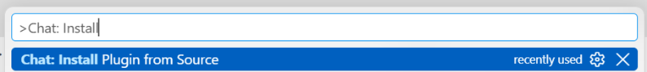
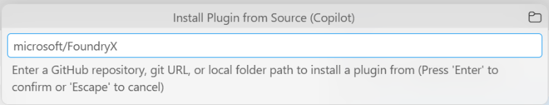
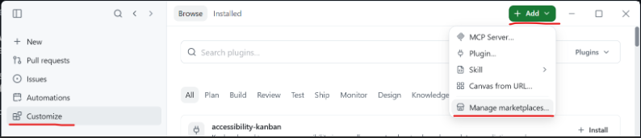
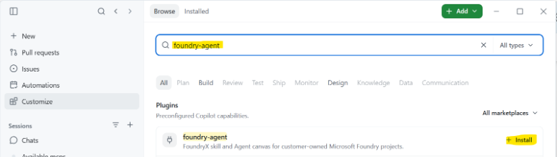

# FoundryX builder concepts and reference

> [!IMPORTANT]
> FoundryX is an experimental project. It is currently available only by invitation to selected customers.

Use FoundryX to build, deploy, and operate agents in a Microsoft Foundry project prepared by your organization. Sign in with your work or school account—you don't need your own Azure subscription or individual Azure roles.

To build your first agent step by step, follow [Walkthrough: Build and operate your first agent](build-first-agent.md).

## In this reference

- [Get started with the plugin](#get-started-with-the-plugin)
- [Install in VS Code or VS Code Insiders](#vs-code-or-vs-code-insiders)
- [Install in the GitHub Copilot app](#github-copilot-app)
- [Install in GitHub Copilot CLI](#github-copilot-cli)
- [Upgrade the plugin and CLI](#upgrade-the-plugin-and-cli)
- [Understand builder access](#understand-builder-access)
- [Choose CLI, Copilot, or Canvas](#choose-cli-copilot-or-canvas)
- [Configure and develop an agent](#configure-and-develop-an-agent)
- [Reuse approved tools](#reuse-approved-tools)
- [Manage deployed agents in Canvas](#manage-deployed-agents-in-canvas)
- [Evaluate and improve an agent](#evaluate-and-improve-an-agent)
- [Monitor and troubleshoot an agent](#monitor-and-troubleshoot-an-agent)
- [Publish to your organization](#publish-to-your-organization)
- [Manual CLI setup (optional)](#manual-cli-setup-optional)
- [Troubleshoot](#troubleshoot)

## Get started with the plugin

Install the `foundry-agent` plugin in your GitHub Copilot client using the steps below. Then start a new chat in your workspace and [describe the agent you want to build](build-first-agent.md).

You don't need to install the FoundryX command-line interface (CLI) manually first. When you run `/foundry-agent`, the skill checks `foundryx --version`, installs the CLI if missing, or updates it if it's older than **0.7.5** (`-dev` and `-staging` builds are also supported). Complete Microsoft sign-in when prompted, and never paste passwords, tokens, or connection keys into chat.

- Plugin name: `foundry-agent`
- Marketplace repository: `microsoft/FoundryX` (marketplace name: `foundryx`)

### Before installing

If you previously installed `foundry-agent` from another source, or installed a standalone `foundry-agent` skill or `foundry-canvas` extension, uninstall that older copy first so you don't load duplicate skills. You can keep the native `microsoft-foundry` plugin installed alongside `foundry-agent`.

### VS Code or VS Code Insiders

1. Install [VS Code](https://code.visualstudio.com/download) or [VS Code Insiders](https://code.visualstudio.com/insiders/), set up [GitHub Copilot in VS Code](https://code.visualstudio.com/docs/copilot/setup), and sign in with your GitHub account.
2. Open the Command Palette (**Ctrl+Shift+P** on Windows/Linux or **Cmd+Shift+P** on macOS).
3. Select **Chat: Install Plugin from Source**.

   

4. Enter `microsoft/FoundryX` (or `https://github.com/microsoft/FoundryX`), press **Enter**, and confirm the trust prompt.

   

5. Open the Command Palette, run **Chat: Open Customizations**, select **Plugins**, and confirm `foundry-agent` is enabled.
6. Start a new Copilot chat and [confirm the installation](#confirm-the-installation).

If **Chat: Install Plugin from Source** isn't visible, update VS Code and verify that `chat.plugins.enabled` is turned on. See [VS Code agent plugins](https://code.visualstudio.com/docs/agent-customization/agent-plugins).

### GitHub Copilot app

1. Install and open the [GitHub Copilot app](https://github.com/github/app#install), and sign in with your GitHub account.
2. In the sidebar, select **Customize**, and then select **+ Add** > **Manage marketplaces...** (or use the marketplace settings icon next to the marketplace dropdown).

   

3. In **Source**, enter `microsoft/FoundryX` and select **Add**.
4. Close **Manage marketplaces**. On the **Browse** tab, search for `foundry-agent` (filtering by `foundryx` or **All marketplaces**).
5. Select **Install** on `foundry-agent` ("FoundryX skill and Agent canvas for customer-owned Microsoft Foundry projects").

   

6. Select **Installed** to confirm `foundry-agent` is enabled, then start a new local session and [confirm the installation](#confirm-the-installation).

For more details, see [Customizing the GitHub Copilot app](https://docs.github.com/en/copilot/how-tos/github-copilot-app/customize-github-copilot-app).

### GitHub Copilot CLI

1. Install [GitHub Copilot CLI](https://docs.github.com/en/copilot/how-tos/copilot-cli/set-up-copilot-cli/install-copilot-cli), run `copilot` once to sign in to GitHub, and then exit the session.
2. In your terminal, add the marketplace and install the plugin:

   ```text
   copilot plugin marketplace add microsoft/FoundryX
   copilot plugin install foundry-agent@foundryx
   ```

3. Verify that `foundry-agent` is enabled:

   ```text
   copilot plugin list
   ```

   If it's disabled, run `copilot plugin enable foundry-agent@foundryx`.
4. Run `copilot` in your workspace directory and [confirm the installation](#confirm-the-installation).

### Confirm the installation

In a new chat session, type `/foundry-agent` (or select `foundry-agent` from the skill picker). Once the skill is available, continue to [Walkthrough: Build and operate your first agent](build-first-agent.md).

### Local checkout (optional)

If you're developing the plugin locally, install it from your local repository path (`copilot plugin install <path-to-FoundryX>` or **Chat: Install Plugin from Source** in VS Code). Reinstall and start a new session after making local package changes.

### Upgrade the plugin and CLI

Update `foundry-agent` in the client where you installed it, and then start a new session:

| Client | How to update |
| --- | --- |
| **GitHub Copilot CLI** | Run `copilot plugin update foundry-agent@foundryx`. |
| **VS Code / Insiders** | Run **Chat: Open Customizations** from the Command Palette and update the plugin. |
| **GitHub Copilot app** | Open **Customize** and update `foundry-agent`. |
| **Local checkout** | Pull the latest changes and reinstall from your local path. |

When you use `/foundry-agent`, the skill checks your FoundryX CLI and updates it if it's older than **0.7.5**.

## Understand builder access

To build and deploy agents, your administrator must register a Foundry project, allow at least one ready model deployment, and grant you **User**, **Manager**, or **Owner** access (**Consumer** allows invoking agents only). For the full role comparison table, see [What project access do users receive?](admin-portal-permissions.md#4-what-project-access-do-users-receive).

You can inspect your project access and allowed models at any time:

```text
foundryx access show
foundryx access project list
foundryx access show --project <project-id>
foundryx model list --project <project-id>
foundryx access check --project <project-id> --action agent.deploy --model <deployment-name>
```

Always pass the **FoundryX project universally unique identifier (UUID)** from `foundryx access project list`, not the Azure resource ID, and use the model's deployment `name` where `allowed: true`.

## Choose CLI, Copilot, or Canvas

| Surface | Best for |
| --- | --- |
| **Copilot (`/foundry-agent`)** | Describing what you want to build, generating code and `foundryx.yaml`, and letting Copilot run CLI commands for you. |
| **FoundryX CLI (`foundryx`)** | Running sign-in, access checks, local testing, deployment, invocation, logs, evaluations, metrics, traces, and publishing directly in your terminal. |
| **FoundryX Canvas (`foundryx-canvas`)** | Viewing your deployed agents, checking endpoints, enabling or disabling Hosted agents, viewing monitoring charts, and submitting agents for publishing. |

## Configure and develop an agent

Store your agent files and `foundryx.yaml` in a local workspace folder.

| Agent kind | Configuration | How you test and deploy |
| --- | --- | --- |
| **Prompt** | Instructions, model deployment, and optional built-in tools in `foundryx.yaml` (no custom code). | Deploy with `foundryx agent deploy`, then invoke remotely. |
| **Hosted** | Python code (`main.py`, `requirements.txt`) plus `foundryx.yaml`. | Scaffold from `basic`, `tools`, or `toolbox`. Test `basic` and `tools` locally with `foundryx agent run`, or deploy and invoke remotely. |

### Prompt agent

Create `foundryx.yaml` with your project UUID and approved model deployment name:

```yaml
version: 1
project: <project-id>
agent:
  kind: prompt
  name: supply-chain-assistant
  model: <deployment-name>
  instructions: Summarize supplied inventory information and identify supplier risks. Do not invent business data.
  deployment: {}
```

Deploy and test the agent:

```text
foundryx agent deploy
foundryx agent invoke "We have 20 units left and expect 35 orders before the next delivery. Summarize the risk."
```

### Hosted agent

Scaffold a new Hosted agent from a built-in sample (`basic`, `tools`, or `toolbox`):

```powershell
foundryx agent sample list
foundryx agent init .\my-agent --sample basic
Set-Location .\my-agent
```

In `foundryx.yaml`, set `project`, a unique `agent.name`, `agent.model`, and `agent.tool_resources` (`[]` if the agent uses no project tools).

To test a `basic` or `tools` sample locally (requires Python):

1. Start the local server in one terminal:

   ```text
   foundryx agent run
   ```

2. In a second terminal in the same folder, invoke the local agent:

   ```text
   foundryx agent invoke "Hello" --local
   ```

`foundryx agent run` uses your FoundryX session (`az login` is not required). Note that `toolbox` agents cannot run locally—deploy and test them remotely instead.

### Deploy and update

1. Check `.agentignore` so you don't upload secrets, `.venv`, or unrelated files.
2. Deploy and test remotely:

   ```text
   foundryx agent deploy
   foundryx agent invoke "Hello"
   ```

`foundryx agent deploy` writes the deployed agent ID, version, and endpoint back to `foundryx.yaml`. To update the agent later, edit your code or instructions and run `foundryx agent deploy` again.

To inspect or invoke an agent from outside its folder, pass `--agent-id` and `--project`:

```text
foundryx agent show <agent-id> --project <project-id>
foundryx agent invoke "Hello" --agent-id <agent-id> --project <project-id>
```

## Reuse approved tools

List the connections and Toolboxes available in your project:

```text
foundryx connection list --project <project-id>
foundryx connection show <connection-name> --project <project-id>
foundryx toolbox list --project <project-id>
foundryx toolbox show <toolbox-name> --project <project-id>
foundryx toolbox version list <toolbox-name> --project <project-id>
```

To use an approved Toolbox in a Hosted agent:

1. Copy the `endpoint` from `foundryx toolbox show <toolbox-name> --project <project-id>` (add `--version <version>` if you want a pinned version instead of the default version) and set it as `TOOLBOX_ENDPOINT` in `main.py`.
2. Add `toolbox:<toolbox-name>` under `agent.tool_resources` in `foundryx.yaml`.
   - An allowed Toolbox automatically covers its internal tools and same-project connections. Only add `connection:<name>` or `builtin:<type>` if your code calls them directly outside the Toolbox.
3. Verify policy authorization before deploying:

   ```text
   foundryx access check --project <project-id> --action agent.deploy --model <deployment-name> --tool toolbox:<toolbox-name>
   ```

Never hardcode credentials or tokens in your code or `foundryx.yaml`. Only a FoundryX **Owner** can create or modify connections and Toolboxes.

### Try prepared resources when available

If your administrator has prepared these example Toolboxes in your project, you can ask Copilot to use them:

| Scenario | Example Copilot prompt |
| --- | --- |
| **Shared GitHub repository access** | `/foundry-agent Build a Hosted agent that answers repository questions using the existing GitHubToolbox. Discover it in my project first.` |
| **Your own GitHub account (OAuth)** | `/foundry-agent Build a Hosted agent using the existing GitHubOAuthToolbox. Keep per-user identity delegation.` |
| **Document search** | `/foundry-agent Build an agent that searches the prepared Contoso documents. Inspect the project's existing search resources before configuring it.` |
| **Your Microsoft 365 email and meetings** | `/foundry-agent Build a Hosted agent using the existing WorkIQToolbox to answer questions about my own email and meetings.` |

### Complete per-user tool consent

When you invoke a remote Hosted agent that uses per-user OAuth, it may return `oauth_consent_required`:

1. Open the returned consent URL in your browser and sign in with the same account you used to invoke the agent.
2. Resume the conversation using the returned conversation ID:

   ```text
   foundryx agent invoke "Continue the original request." --agent-id <agent-id> --project <project-id> --conversation-id <conversation-id>
   ```

## Manage deployed agents in Canvas

In a Copilot client that supports Canvas, open FoundryX Canvas by asking:

```text
/foundry-agent List all my agents in the FoundryX Canvas.
```

Canvas lists agents created by you in enabled projects where you have **User**, **Manager**, or **Owner** access. Select an agent name to view its details, or open its **Actions** menu:

| Action | What it does |
| --- | --- |
| **Enable agent / Disable agent** | Starts or stops a Hosted agent (`foundryx agent hosted enable` / `disable`). |
| **Get agent endpoint** | Displays the protocol URLs to copy (`foundryx agent show`). |
| **Publish** | Opens the form to submit the latest ready agent version for Microsoft 365 / Teams review. |
| **Delete** | Permanently deletes the agent and its FoundryX publishing Bot/channel after you confirm the agent name (`foundryx agent delete <agent-id> --project <project-id> --name "<exact-agent-name>"`). Does not remove an already published Microsoft 365 catalog entry. |

To list all agents in a project from the CLI, run `foundryx agent list --project <project-id>` (add `--owned-only` if supported to filter to your own agents).

## Evaluate and improve an agent

You can run billable evaluations against your deployed agent using native Foundry evaluators and datasets.

Ask Copilot to set up an evaluation:

```text
/foundry-agent Set up an evaluation for this agent. Show the dataset, evaluators, judge model, and costs to review before running it.
```

Or run the evaluation workflow from the CLI:

```text
foundryx agent eval evaluator list --project <project-id>
foundryx agent eval dataset list --project <project-id>
foundryx agent eval dataset show <dataset-name> <dataset-version> --project <project-id>
foundryx agent eval run --config eval.yaml --agent-id <agent-id> --project <project-id>
foundryx agent eval show <eval-id> --eval-run-id <run-id> --items --project <project-id>
```

To compare a new agent version against a baseline run with the same `eval.yaml`:

```text
foundryx agent eval run --config eval.yaml --eval-id <eval-id> --agent-version <candidate-version> --agent-id <agent-id> --project <project-id>
foundryx agent eval compare <eval-id> <baseline-run-id> <candidate-run-id> --project <project-id>
```

Note that evaluations run under the backend application identity, so tools that require interactive per-user OAuth consent cannot run during evaluation.

## Monitor and troubleshoot an agent

In FoundryX Canvas, select the **Monitor** tab, choose your subscription, project, agent, and time range, and select **Refresh**. (Allow a few minutes for new telemetry to appear in Application Insights.)

You can also check metrics, Hosted container logs, and conversation traces from the CLI:

```text
foundryx agent metrics --list
foundryx agent metrics <agent-id> --project <project-id>
foundryx agent hosted logs <agent-id> --type console --tail 50 --project <project-id>
foundryx agent hosted logs <agent-id> --type system --tail 50 --project <project-id>
foundryx agent conversation show <conversation-id>
foundryx agent trace query --help
```

Or ask Copilot to inspect your recent traces:

```text
/foundry-agent Analyze the performance of my recent agent calls. Use traces from my conversations and explain any missing data.
```

## Publish to your organization

Publishing prepares an Azure Bot channel (which can incur S1 Bot charges) and submits your agent package for Microsoft 365 or Teams administrator approval. Once approved by a tenant administrator, users in your organization's catalog can access the published agent even if they aren't FoundryX project members.

### Publish from Canvas

1. On your ready agent, select **Actions** > **Publish**.
2. Review **Package version**, **Developer name**, **Short description**, and **Description**.
3. Open **Publisher URLs** and enter your organization's real developer, privacy, and terms URLs.
4. Select **Confirm tenant publishing**, select **Publish**, and complete the publishing sign-in prompt with the same account.

### Publish from the CLI

1. Preview the publishing plan first (without `--yes`):

   ```text
   foundryx agent publish <agent-id> --project <project-id> --app-version 1.0.0 --short-description "<short-description>" --description "<description>" --developer-name "<developer-name>" --developer-website <https-url> --privacy-url <https-url> --terms-of-use-url <https-url>
   ```

2. Review the plan output, then run the same command with `--yes` to submit.
3. Check your publishing sign-in and submission status:

   ```text
   foundryx auth publish login
   foundryx auth publish status
   foundryx agent publish-status <agent-id> --project <project-id>
   ```

After `publish-status` shows `submitted`, ask your Microsoft 365 administrator to approve the request in the [Microsoft 365 admin center](https://admin.cloud.microsoft/). Increment `--app-version` whenever you submit a new package update.

## Manual CLI setup (optional)

If you want to install the CLI manually instead of letting the `/foundry-agent` skill manage it:

1. If `foundryx` is already installed, run `foundryx --version`. Keep it if it's **0.7.5** or later.
2. Otherwise, open [FoundryX CLI releases](https://github.com/microsoft/FoundryX/releases?q=FoundryX&expanded=true) and download the binary for your service environment, operating system, and architecture.
3. Place `foundryx.exe` (Windows) or `foundryx` (macOS/Linux, with `chmod +x`) in a folder on your `PATH`. (On Linux, make sure `libsecret-1` and a Secret Service keyring are running.)
4. Verify the CLI and sign in:

   ```text
   foundryx --version
   foundryx auth login --tenant <tenant-id>
   foundryx auth status
   ```

Reload FoundryX Canvas after switching accounts or tenants so it picks up your updated session.

## Troubleshoot

| Symptom or error code | What to check and do |
| --- | --- |
| `foundryx` is not found | Ask `/foundry-agent` to install the CLI, or follow [Manual CLI setup](#manual-cli-setup-optional). |
| **Plugin or Canvas is missing** | Run `copilot plugin list`, start a new chat session, and remove any duplicate older plugins. |
| **Tenant is inactive or no projects appear** | Check `foundryx auth status` and `foundryx access show`. Ask your administrator to confirm tenant onboarding and your project grant. |
| **You can invoke agents but cannot build** | Ask your administrator for **User**, **Manager**, or **Owner** access on the project. |
| `model_not_allowed` or `tool_not_allowed` | Check allowed resources with `foundryx model list` or `foundryx toolbox list`, or ask your administrator to allow the resource in **Edit access**. |
| `model_not_ready` | Choose an allowed model deployment whose status is `Succeeded`. |
| `project_owner_required` | Reuse existing project connections and Toolboxes, or ask a FoundryX **Owner** to create or update them. |
| **Local run fails to start** | Check that Python and the packages in `requirements.txt` are available. |
| **Toolbox agent fails with `agent run` or `--local`** | Deploy the agent with `foundryx agent deploy` and invoke it remotely—the local gateway does not proxy Toolbox Model Context Protocol (MCP) calls. |
| `oauth_consent_required` | Open the returned consent URL in your browser with the same account, complete consent, and rerun `foundryx agent invoke` with `--conversation-id`. |
| `hosted_tool_declarations_unknown` | Redeploy the Hosted agent from source with explicit `tool_resources` in `foundryx.yaml`. |
| **Canvas says the account changed** | Check `foundryx auth status` and reload Canvas. |
| **Monitoring or evaluation data is missing** | Wait a few minutes for Application Insights ingestion, check your filters, or ask your administrator to verify project monitoring setup. |
| **Published agent is not in the store yet** | Check `foundryx agent publish-status` and ask your Microsoft 365 administrator to approve the submitted app in the Microsoft 365 admin center. |

When contacting support, include the command or action, error code, request ID, environment, CLI version, and timestamp. Never share passwords, tokens, or connection keys.
