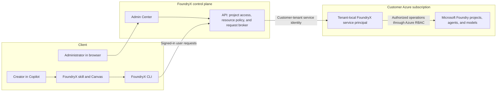

# FoundryX overview

**From employee intent to a governed Foundry agent.**

> [!IMPORTANT]
> FoundryX is an experimental project. It is currently available only by invitation to selected customers.

FoundryX adds a SaaS-like control plane and a Copilot plugin to Microsoft Foundry.
Employees describe a business outcome, and a coding agent helps turn that intent
into inspectable source, configuration, and a deployed Foundry agent. Employees
use projects, models, and tools approved by their organization without needing
their own Azure subscription or individual Azure roles for normal agent work.

Microsoft Foundry remains the underlying platform for models, agents, tools,
knowledge, observability, evaluation, and optimization. FoundryX separates the
creator experience from Azure administration; it does not replace Foundry or move
the customer's Foundry resources into a separate platform.

## Who it is for

FoundryX is for organizations that administer Azure and want more employees to
build agents under central governance. Creators include
application developers, automation engineers, data developers, and technically
capable domain experts.

Central teams prepare projects, model deployments, quota, networking, and
dependencies, then give employees controlled access to those resources.

| Audience | Responsibility |
| --- | --- |
| Creators, called Builders in the guides | Describe the task, review generated artifacts, build and test agents, and operate them within project policy. |
| Central AI and IT teams | Prepare projects, approve models and tools, assign access, and manage security and production readiness. |
| FinOps teams | Retain oversight of the organization's Azure resources, quota, and spending. |

## How it works

Employees sign in with Microsoft Entra ID. FoundryX resolves their project
membership and resource policy before brokering supported operations to Microsoft
Foundry in the customer's Azure subscription.

The diagram shows the main service path. Administrative Azure management
operations also use the administrator's delegated authority. The FoundryX API
checks employee access before using the customer-tenant service identity;
employees do not receive that identity's credentials.

### Three separate access boundaries

| Boundary | What it controls |
| --- | --- |
| Tenant onboarding | Admits the organization to FoundryX and obtains the required administrator consent. Consent alone does not grant access to Azure resources. |
| Azure resource administration | Uses an authorized administrator's Azure access to create or register projects and provision service access. |
| FoundryX project membership and policy | Determines who can use or build agents and which models and tools they can use in a registered project. |

A FoundryX project role is not an Azure subscription role. Subscription
administration does not automatically grant Project Owner membership.
Project policy applies to all project members, including Owners.

The organization retains ownership of its subscriptions, resources, quota, costs,
and security policy. Removing the need for individual Azure roles does not remove
Azure charges, external tool consent, or production review requirements.
See [administration concepts and reference](enterprise-admin-agent-access.md)
for the access model and its limits.

## The experience

### Administrators prepare the environment

An administrator completes tenant onboarding, creates or selects a native Foundry
project, and registers it in FoundryX. The administrator chooses allowed models
and tools, then assigns project roles to Microsoft Entra users or groups.
Tenant-wide access is also available for the supported roles.

In the Admin Center, select **Access** > **Grant access** to register a project.
Use **Edit access** for later changes and **Remove access** to remove its FoundryX
registration without deleting the native project.

This gives creators a prepared environment rather than asking each employee to
configure Azure resources. Follow the
[project registration walkthrough](register-project-permissions.md) for the
current Admin Center workflow.

### Creators build and operate agents

Creators use Copilot with the FoundryX skill to describe an outcome, discover
approved resources, and produce source and configuration they can inspect.
They review important choices, deploy, invoke the agent, and use evaluation and
monitoring to guide improvements.

| Surface | Current purpose |
| --- | --- |
| Copilot plugin, `foundry-agent` | Provides the `/foundry-agent` skill and FoundryX Canvas. The coding agent uses the skill and CLI to develop and operate agents. |
| FoundryX CLI, `foundryx` | Provides sign-in, resource discovery, access checks, agent deployment and invocation, evaluation, diagnostics, and publishing workflows. It is separate from the plugin; the skill handles its setup when needed. |
| FoundryX Canvas, `foundryx-canvas` | Provides a graphical view of deployed agents, details, lifecycle actions, monitoring, and publishing. It is not a source editor or an interactive agent chat. |

The plugin supports Prompt and Hosted agent workflows. Canvas requires a
Copilot host with Canvas extension support; the CLI remains usable without it.
This plugin is separate from the native `microsoft-foundry` plugin and its
`azd ai` workflow.

Deployment and publishing are separate operations. Publishing to Microsoft 365
or Teams requires additional setup and tenant administrator review; a successful
deployment does not make an agent available in an organization catalog.
See the [Builder guide](builder-guide.md) for current capabilities and limits.

## Table of contents

Use these guides to prepare your organization's environment and build and
operate agents. For installation, see
[Install the Copilot plugin](builder-guide.md#get-started-with-the-plugin); the skill guides CLI setup and sign-in.

| Document | Audience | What it covers |
| --- | --- | --- |
| [Tenant onboarding requirements](tenant-onboarding-requirements.md) | Administrators | Required Microsoft Entra roles, administrator consent, and tenant activation. |
| [Administration concepts and reference](enterprise-admin-agent-access.md) | Administrators | Access boundaries, project roles, model and tool policies, membership, and troubleshooting. |
| [Walkthrough: Grant project access](register-project-permissions.md) | Administrators | Register an existing Foundry project, select allowed resources, assign roles, and verify employee access. |
| [Builder concepts and reference](builder-guide.md) | Builders | Plugin-first setup, upgrades, access, CLI and Canvas capabilities, tools, evaluation, monitoring, publishing, and optional manual CLI setup. |
| [Walkthrough: Build and operate your first agent](build-first-agent.md) | Builders | Install the plugin, let Copilot guide setup and sign-in, then create, deploy, invoke, and inspect an agent. |

### Supporting script

[Check-FoundryXAdminConsentRole.ps1](Check-FoundryXAdminConsentRole.ps1) checks
active Microsoft Entra administrator roles before tenant onboarding. Follow the
[preflight role check](tenant-onboarding-requirements.md#preflight-role-check)
instructions before running it.
