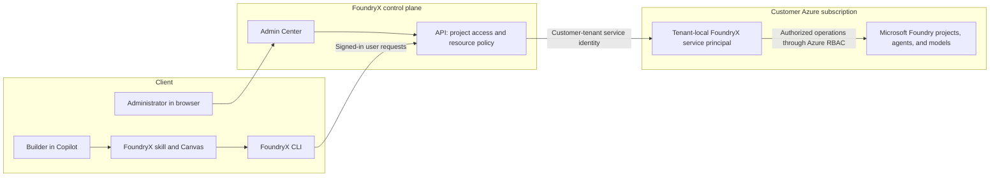

# FoundryX overview

**Turn your ideas into governed Microsoft Foundry agents.**

> [!IMPORTANT]
> FoundryX is an experimental project. It is currently available only by invitation to selected customers.

FoundryX adds an access control plane and a GitHub Copilot plugin to Microsoft Foundry. You describe what you want to build, and Copilot helps you create, deploy, and run a Foundry agent using models and tools that your organization approves. You don't need your own Azure subscription or individual Azure role-based access control (RBAC) assignments for everyday agent work.

Microsoft Foundry remains your platform for models, agents, tools, knowledge, evaluation, and monitoring. Your organization keeps its resources in its own Azure subscription.

## Who uses FoundryX

FoundryX helps central IT and AI teams share prepared Azure resources with builders across the organization.

| Role | What you do |
| --- | --- |
| **Builders** (developers, engineers, domain experts) | Describe the task, review generated code and settings, and build, test, and run agents within your project's policy. |
| **Central AI and IT administrators** | Onboard the tenant, register Foundry projects, approve models and tools, and assign project access. |
| **FinOps teams** | Track Azure subscriptions, quota, and spending. |

## How FoundryX works

You sign in with Microsoft Entra ID. The FoundryX application programming interface (API) checks your project role and resource allowlist before running operations in your organization's Azure subscription through a tenant-local service principal.

### Three access layers

FoundryX separates organization onboarding, Azure administration, and project access:

| Layer | What it controls |
| --- | --- |
| **Tenant onboarding** | Connects your Microsoft Entra tenant and approves application permissions. |
| **Azure subscription administration** | Lets an Azure administrator register projects and set up access for the FoundryX service principal. |
| **FoundryX project access** | Controls who can invoke or build agents and which models and tools they can use in a registered project. |

For details on how these layers work together, see [Admin Center permissions by page](admin-portal-permissions.md).

## Workflow summary

### 1. Administrators prepare the project

1. Complete [tenant onboarding](tenant-onboarding-requirements.md) with an eligible Microsoft Entra administrator account.
2. In the Admin Center, select **Access** > **Grant access** to register an existing Microsoft Foundry project and assign project roles to users or groups.
3. Select **Edit access** > **Models & Tools** to choose the models and tools that project members can use.

Follow the [Walkthrough: Grant project access](register-project-permissions.md) for step-by-step instructions.

### 2. Builders create and run agents

1. [Install the Copilot plugin](builder-guide.md#get-started-with-the-plugin) (`foundry-agent`) in VS Code, the GitHub Copilot app, or GitHub Copilot command-line interface (CLI).
2. Run `/foundry-agent` to sign in, choose an approved project and model, and build a Prompt or Hosted agent.
3. Deploy, test, evaluate, monitor, and optionally publish your agent using Copilot, the `foundryx` CLI, or FoundryX Canvas.

Follow the [Walkthrough: Build and operate your first agent](build-first-agent.md) to get started.

## Table of contents

| Guide | Audience | What you'll learn |
| --- | --- | --- |
| [Tenant onboarding requirements](tenant-onboarding-requirements.md) | Administrators | Required Microsoft Entra roles, preflight role check, consent permissions, and tenant activation. |
| [Admin Center permissions by page](admin-portal-permissions.md) | Administrators | Permissions needed to sign in, register projects, load models and tools, and assign FoundryX project roles. |
| [Administration concepts and reference](enterprise-admin-agent-access.md) | Administrators | Project registration details, model and tool policies, membership management, and troubleshooting. |
| [Walkthrough: Grant project access](register-project-permissions.md) | Administrators | Step-by-step guide to registering a project, allowing models and tools, and verifying user access. |
| [Builder concepts and reference](builder-guide.md) | Builders | Plugin installation and upgrades, CLI and Canvas usage, tools, evaluation, monitoring, and publishing. |
| [Walkthrough: Build and operate your first agent](build-first-agent.md) | Builders | Step-by-step guide to building, deploying, invoking, and inspecting your first agent. |

### Supporting script

Download [`Check-FoundryXAdminConsentRole.ps1`](https://github.com/microsoft/FoundryX/releases/download/Check-FoundryXAdminConsentRole-v1/Check-FoundryXAdminConsentRole.ps1) and follow the [preflight role check](tenant-onboarding-requirements.md#preflight-role-check) instructions to verify your Microsoft Entra administrator role before onboarding.
