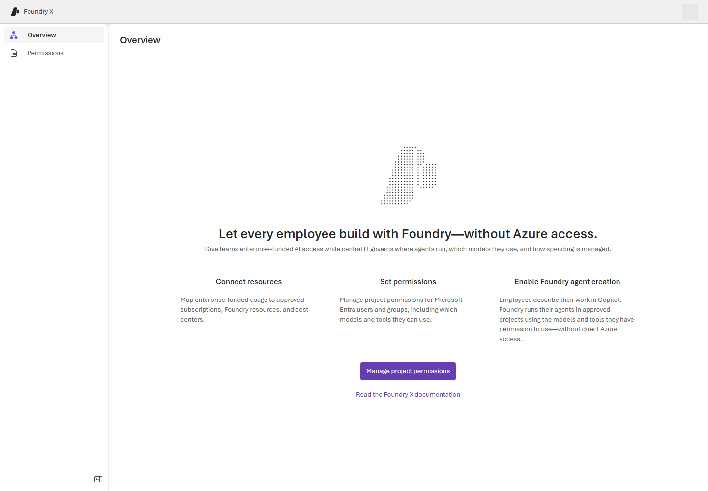
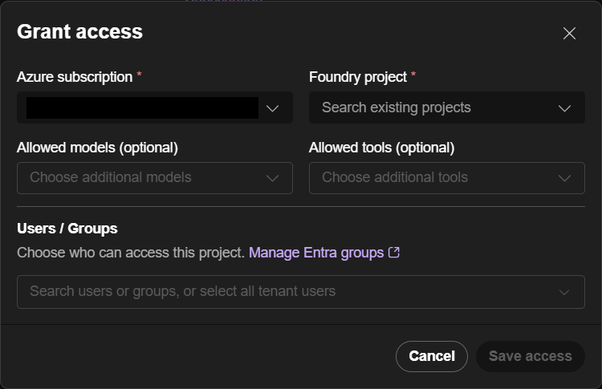

# Walkthrough: Register project permissions

> [!IMPORTANT]
> FoundryX is an experimental project. It is currently available only by invitation to selected customers.

Register an existing Microsoft Foundry project in FoundryX, choose the models and tools that employees can use, and assign access. At the end of this walkthrough, the project has a saved permission and a representative employee has verified their access.

For role definitions, policy semantics, and administration options, see [FoundryX administration concepts and reference](enterprise-admin-agent-access.md).

## Before you begin

Confirm these prerequisites:

- The target tenant is active in FoundryX. Complete [tenant onboarding](tenant-onboarding-requirements.md) first if needed.
- You are Subscription Owner, or have both Contributor and User Access Administrator at subscription scope. Activate eligible roles before continuing. Project Owner membership alone does not permit registration.
- You have an existing project under a Foundry account with resource kind `AIServices`, in a subscription in the target tenant.
- The project has a ready model deployment if employees must build or invoke agents. Required project connections and Toolboxes are already configured.
- You know which users, groups, or tenant-wide audience need access and which roles they require.

If you need to create resources first, see [Prepare the tenant and resources](enterprise-admin-agent-access.md#prepare-the-tenant-and-resources).

Saving a permission provisions Azure access for the FoundryX service identity. Review the [access scopes](enterprise-admin-agent-access.md#know-what-project-registration-grants) before proceeding. Use your organization's sign-in process; do not use shared administrator credentials.

## 1. Sign in to the Admin Center

1. Open [FoundryX Admin Center (staging)](https://foundryx-portal-staging.redsea-0f4601f0.westus2.azurecontainerapps.io/). For another environment, use the address supplied by your service operator.
2. Sign in with your work or school account. The root address selects the account's home tenant.
3. To select a different tenant where you are a member or guest, use `https://<admin-center-host>/?tenant=<tenant-id>`.
4. If already signed in, open **Account**, find **Current directory**, and select **Switch**. Use **Switch account** when you need a different identity.

Older `/t/<tenant-id>` links redirect to the tenant-query form. Switching tenants does not grant access or onboard a tenant.



*The staging Admin Center landing page after sign-in. The account button is masked to exclude account details.*

## 2. Select the project

1. On **Overview**, select **Manage project permissions** or **Permissions** in the left navigation.
2. Select **New permission**.
3. Select **Azure subscription**.
4. Select **Foundry project**. The picker lists existing projects that are not already registered.

If a project is already registered, open its existing permission instead of creating another. Use **Create new Foundry project** to create a native project in Foundry if needed, then reopen the form to discover it.

Discovery uses your signed-in Azure identity. If it is denied, resolve that error; the service does not substitute its own identity.



*The deployed preview form before resource or identity selection. No account or tenant-specific values are shown. Preview deployments can differ in labels and optional fields.*

## 3. Choose allowed models and tools

1. In **Allowed models**, select the required model deployment names. The form can preselect existing GPT-5 deployments; review those selections. Selecting a model does not deploy one.
2. In **Allowed tools**, select the required built-in tools, project connections, and Toolboxes. For a Toolbox, include its referenced project connections.
3. Review both selections before continuing. An empty model list blocks model use and agents that require a model; it does not mean all models.

The form automatically includes **Web search** when available and does not let you clear it in the picker. If the required policy must exclude it or deny all tools, see [Set an explicit policy through the CLI](enterprise-admin-agent-access.md#set-an-explicit-policy-through-the-cli). Verify that policy again after any portal edits.

If tool discovery fails, the form can offer to save with **tools disabled**. This saves an empty tool allowlist. Resolve the error, then edit the permission to enable the intended tools.

For details, see [model policy semantics](enterprise-admin-agent-access.md#control-model-access-and-deployment) and [tool requirements](enterprise-admin-agent-access.md#prepare-and-allow-tools).

## 4. Assign employee access

1. Under **Microsoft Entra identity**, search for and select the intended users or groups. Select the tenant only if access is intended for all tenant users.
2. Review each **Foundry X role**. Newly selected identities default to **Consumer** in this registration workflow. Change employees who must build agents to **User**.
3. Assign **Owner** to the individual or group responsible for connection and Toolbox administration. Subscription authority does not supply that project role.

Select at least one identity before saving. Tenant-wide grants support Consumer or User, not Manager or Owner. Some preview deployments label the section **Microsoft Entra access**.

For the full role definitions and overlapping-grant behavior, see [Choose the correct project role](enterprise-admin-agent-access.md#choose-the-correct-project-role).

## 5. Save and review the permission

1. Select **Save permissions** and wait for the operation to finish.
2. Open the permission by its project name.
3. Confirm the selected models, allowed tools, Microsoft Entra identities, and roles.
4. If tools were disabled during registration, resolve the discovery problem and use **...** > **Edit** to select the intended tools, then **Save changes**.

Saving requires a selected project, at least one identity, and successful model discovery. A successful discovery can return no models; a failed discovery cannot be treated as an empty list.

If the permission shows **Import incomplete**, it remains disabled. Open **...** > **Retry import** after resolving the error. If Azure access is still propagating, wait before retrying.

A failed save can leave the import, policy, or some membership changes applied. Reopen the permission, inspect the current state, and complete only the missing changes. Do not assume the whole form was rolled back.

See [Registration lifecycle](enterprise-admin-agent-access.md#registration-lifecycle) for what saving does and [Troubleshoot](enterprise-admin-agent-access.md#troubleshoot) for recovery options.

## 6. Verify employee access

1. Have a representative employee sign in to the same FoundryX environment and tenant.
2. After [installing the CLI](../README.md#prerequisites), have the employee sign in and inspect their access:

   ```text
   foundryx --version
   foundryx auth login --tenant <tenant-id>
   foundryx auth status
   foundryx access show
   foundryx access project list
   foundryx access show --project <project-id>
   foundryx access check --project <project-id> --action agent.deploy --model <deployment-name>
   ```

3. Confirm that the employee has at least User access, the project is enabled, and the required resources are allowed. Use the FoundryX project UUID returned by `access project list`, not the native Azure resource ID.
4. For an agent with tools, include every declared resource in the authorization check:

   ```text
   foundryx access check --project <project-id> --action agent.deploy --model <deployment-name> --tool toolbox:<toolbox-name> connection:<connection-name>
   ```

5. Have the employee deploy a representative agent through their normal [plugin workflow](../README.md#use), then invoke it. Deployment and invocation can incur costs:

   ```text
   foundryx agent invoke "Verify the configured tool with a non-sensitive request." --agent-id <agent-id> --project <project-id>
   ```

6. Complete any per-user tool consent. Verify the actual tool result, not only the agent's text response.

Authorization checks make no resource changes and do not prove runtime health. See [Authorization and runtime verification](enterprise-admin-agent-access.md#authorization-and-runtime-verification) for the meaning of the check results.

Give employees the tenant sign-in link, FoundryX project UUID, approved model deployment names, approved tool names or endpoints, and the contact for access changes. Do not send backend credentials or ask employees to use an administrator account.

## Next steps

- [Control model access and deployment](enterprise-admin-agent-access.md#control-model-access-and-deployment).
- [Prepare and allow tools](enterprise-admin-agent-access.md#prepare-and-allow-tools).
- [Manage project membership](enterprise-admin-agent-access.md#manage-project-membership).
- [Disable or remove a permission](enterprise-admin-agent-access.md#disable-or-remove-a-permission).
