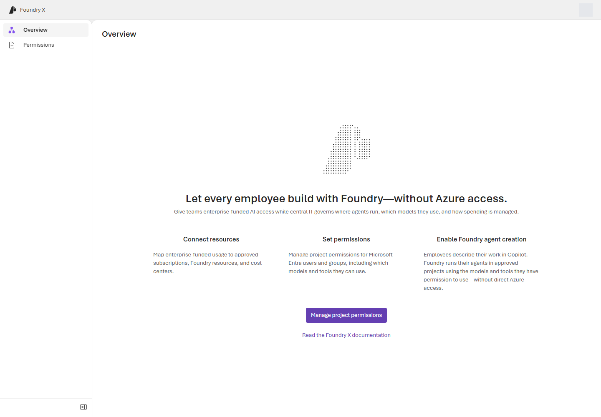

# Walkthrough: Grant project access

> [!IMPORTANT]
> FoundryX is an experimental project. It is currently available only by invitation to selected customers.

Register an existing Microsoft Foundry project in FoundryX, choose the models and tools that employees can use, and assign access. At the end of this walkthrough, the project has saved access settings and a representative employee has verified their access.

For role definitions, policy semantics, and administration options, see [FoundryX administration concepts and reference](enterprise-admin-agent-access.md).

## Before you begin

Review [Admin Center permissions by page](admin-portal-permissions.md) for the
separate subscription, service-principal resource access, and directory requirements.

Confirm these prerequisites:

- The target tenant is active in FoundryX. Complete [tenant onboarding](tenant-onboarding-requirements.md) first if needed.
- You have the [required subscription Access management permissions](admin-portal-permissions.md#required-access-management-actions). Owner, Contributor plus User Access Administrator, or qualifying custom roles can provide them. See the guide's rollout note for older environments. Activate eligible roles before continuing. Project Owner membership alone does not permit registration.
- You have an existing project under a Foundry account with resource kind `AIServices`, in a subscription in the target tenant.
- Your signed-in identity can discover the subscription, parent Foundry account, and native project. The Grant access form does not read the native Toolbox catalog as you. After registration, model and tool discovery uses the FoundryX service principal's resource access.
- The project has a ready model deployment if employees must build or invoke agents. Required project connections and Toolboxes are already configured.
- If granting employee access now, you know which users, groups, or tenant-wide audience need access and which roles they require. Initial assignments are optional; you can add them later.

If you need to create resources first, see [Prepare the tenant and resources](enterprise-admin-agent-access.md#prepare-the-tenant-and-resources).

Saving project access provisions Azure access for the FoundryX service identity. Review the [access scopes](enterprise-admin-agent-access.md#know-what-project-registration-grants) before proceeding. Use your organization's sign-in process; do not use shared administrator credentials.

## 1. Sign in to the Admin Center

1. Open [FoundryX Admin Center (staging)](https://foundryx-portal-staging.redsea-0f4601f0.westus2.azurecontainerapps.io/). For another environment, use the address supplied by your service operator.
2. Sign in with your work or school account. The root address selects the account's home tenant.
3. To select a different tenant where you are a member or guest, use `https://<admin-center-host>/?tenant=<tenant-id>`.
4. If already signed in, open **Account**, find **Current directory**, and select **Switch**. Use **Switch account** when you need a different identity.

Sign-in checks delegated management access. Subscription managers can be asked to
complete Microsoft verification, including MFA required by existing Azure
write/delete policies, before the portal opens. Complete that flow yourself.
This does not grant new Azure roles or change tenant policy. Verification can
still be required later if a token expires or policy changes.

Older `/t/<tenant-id>` links redirect to the tenant-query form. Switching tenants does not grant access or onboard a tenant.



*The current staging Admin Center Overview. The capture excludes navigation and account details.*

## 2. Select the project

1. On **Overview**, select **Manage project access** or **Access** in the left navigation. The list is titled **Access to Foundry project**.
2. Select **Grant access**. The same action appears in the empty state, **No access granted to any Foundry projects yet**.
3. Select **Azure subscription**. If exactly one subscription has the required access-management permissions, the form selects it automatically.
4. Select **Foundry project**. The picker lists existing projects that are not already registered.

If a project is already registered, open its existing access entry instead of creating another. Use **Create new Foundry project** to create a native project in Foundry if needed, then reopen the form to discover it.

Discovery uses your signed-in Azure identity. If it is denied, resolve that error; the service does not substitute its own identity.

The subscription picker can show subscriptions that you can read but cannot
manage. Those choices are disabled. Hover over one, or select **View missing
permissions**, to inspect missing Actions at subscription scope. Use **Copy**
to share the list with your Azure administrator.

Disabled access actions explain the required subscription permissions in their
tooltips. Signing in or seeing a subscription does not permit registration.

## 3. Review employee access

The form preselects your signed-in account as **Owner** under **Users / Groups**.
Review that draft assignment and change or remove it if needed. Opening the form
grants nothing. Initial assignments are optional; remove all selected assignments
to register without employee access and add it later.

1. Under **Users / Groups**, search for and select the intended Microsoft Entra users or groups. Select **All users in \<tenant name\>** only if access is intended for all tenant users.
2. Review each **Foundry X role**, including your preselected Owner assignment. Other newly selected identities default to **Consumer** in this registration workflow. Change employees who must build agents to **User**.
3. Assign **Owner** to the individual or group responsible for connection and Toolbox administration. Subscription authority does not supply that project role.

Tenant-wide grants support Consumer or User, not Manager or Owner. **Manage Entra groups** opens Microsoft Entra guidance; this form does not create or change directory groups. Before employees build agents, grant them User or higher access and allow the required resources.

For the full role definitions and overlapping-grant behavior, see [Choose the correct project role](enterprise-admin-agent-access.md#choose-the-correct-project-role).

## 4. Register the project and review access

1. Select **Grant access** and wait for the operation to finish.
2. Open the access entry by its project name.
3. Review **Access details** and **Users / Groups**. Confirm the saved Microsoft Entra identities and roles, including your own assignment if you kept it.
4. Use **Add Users / Groups** to grant employee access if you deferred assignments. To edit several assignments, use **...** > **Edit access** > **Access**, then **Save**.

The Grant access form has no model or tool pickers. Registration starts with
empty model and tool allowlists, which deny all resources of those types.
Submitting requires a selected project, not initial employee grants. Registration
can still fail while setting up service access or reading native model deployments.
Subscription authority itself does not grant a FoundryX project role; the portal
submits the selected assignments after registration.

If the permission shows **Import incomplete**, it remains disabled. Open **...** > **Retry import** after resolving the error. If Azure access is still propagating, wait before retrying. The retry form's resource pickers use your delegated Azure and native Toolbox permissions, not the service principal. Review and select the intended models and tools before saving: the retry replaces the incomplete registration's policy with those selections, including empty lists.

The portal completes registration or the policy update before saving membership changes together in one atomic batch of at most 500 changes. A rejected batch leaves those membership changes unchanged, but the earlier registration or policy update can remain saved. Reopen the access entry and inspect the current state before retrying, especially if the response outcome is unknown. Do not assume the whole form was rolled back. After additional sign-in verification, the portal does not automatically repeat a save.

Registration does not import pre-existing native agents into FoundryX agent lists or Canvas, and does not delete them.

See [Registration lifecycle](enterprise-admin-agent-access.md#registration-lifecycle) for what saving does and [Troubleshoot](enterprise-admin-agent-access.md#troubleshoot) for recovery options.

## 5. Choose allowed models and tools

1. Open the project's **...** menu and select **Edit access**. The dialog opens on **Models & Tools**.
2. In **Allowed models**, select the required model deployment names. Selecting a model does not deploy one. **Deploy new models in Foundry portal** opens Foundry for separate setup.
3. In **Allowed tools**, select the required built-in tools, project connections, and Toolboxes. An allowed Toolbox permits its configured tools and same-project connections through that Toolbox; separate connection grants are needed only for direct use outside it. **Deploy new tools in Foundry portal** opens Foundry for separate setup.
4. Select **Save**, reopen the access entry, and confirm the saved resource selections before employees use the project.

No models or tools are preselected for a newly registered project. **Web search**
is optional and can be selected or cleared. An empty model list blocks model use
and agents that require a model; an empty tool list denies all tools.

The **Access** tab changes membership. Switching tabs keeps draft changes; it
does not save them. Membership-only edits can be saved without model or tool
discovery and leave the resource policy unchanged. If you have changed a resource
selection and its discovery becomes unavailable, resolve the error before saving.

After registration completes, resource discovery uses the **FoundryX service
principal**, not your personal Azure access. If discovery fails, check its
[model reads](admin-portal-permissions.md#allowed-models) and
[native tool permissions](admin-portal-permissions.md#allowed-tools).
Models and tools load in one shared resource request. The pickers show loading
while that request runs. If it fails, both fields show errors below their
dropdowns. Select **Retry model deployments** or **Retry project tools** to
repeat the shared request. After successful discovery, **No additional models**
means no model deployments were found, and **No available tools** means no
tools were found.

During **Retry import**, models and tools load in separate delegated requests.
A failed tool request shows **No available tools** and an error banner inside
the tools dropdown. Select **Retry project tools** after resolving the error.
An error is not proof that no resources exist. Selecting a tool does not
complete its external authentication.

For details, see [model policy semantics](enterprise-admin-agent-access.md#control-model-access-and-deployment) and [tool requirements, current picker choices, and exclusions](enterprise-admin-agent-access.md#prepare-and-allow-tools).

## 6. Verify employee access

1. Have a representative employee follow the [plugin workflow](builder-guide.md#get-started-with-the-plugin) in the same FoundryX environment and tenant. Let Copilot check CLI setup and guide their Microsoft sign-in.
2. Ask Copilot to inspect the employee's access. For manual CLI verification, follow [optional CLI setup](builder-guide.md#manual-cli-setup-optional), then use:

   ```text
   foundryx --version
   foundryx auth login --tenant <tenant-id>
   foundryx auth status
   foundryx access show
   foundryx access project list
   foundryx access show --project <project-id>
   foundryx access check --project <project-id> --action agent.deploy --model <deployment-name>
   ```

3. Confirm that the employee has at least User access, the project is enabled, and the required resources are allowed. Use the FoundryX project UUID returned by `access project list`, not the native Azure resource ID.
4. For an agent with tools, include every directly used resource in the authorization check. For an agent that uses only a Toolbox:

   ```text
   foundryx access check --project <project-id> --action agent.deploy --model <deployment-name> --tool toolbox:<toolbox-name>
   ```

   Add `connection:<connection-name>` only if the agent also uses that connection directly, outside the Toolbox. Do not separately declare the Toolbox's internal connections or built-in tools.

5. Have the employee deploy a representative agent through their normal [plugin workflow](builder-guide.md#get-started-with-the-plugin), then invoke it. Deployment and invocation can incur costs:

   ```text
   foundryx agent invoke "Verify the configured tool with a non-sensitive request." --agent-id <agent-id> --project <project-id>
   ```

6. Complete any per-user tool consent. Verify the actual tool result, not only the agent's text response.

Authorization checks make no resource changes and do not prove runtime health. See [Authorization and runtime verification](enterprise-admin-agent-access.md#authorization-and-runtime-verification) for the meaning of the check results.

Give employees the tenant sign-in link, FoundryX project UUID, approved model deployment names, approved tool names or endpoints, and the contact for access changes. Do not send backend credentials or ask employees to use an administrator account.

## Next steps

- [Control model access and deployment](enterprise-admin-agent-access.md#control-model-access-and-deployment).
- [Prepare and allow tools](enterprise-admin-agent-access.md#prepare-and-allow-tools).
- [Manage project membership](enterprise-admin-agent-access.md#manage-project-membership).
- [Disable or remove a permission](enterprise-admin-agent-access.md#disable-or-remove-a-permission).
